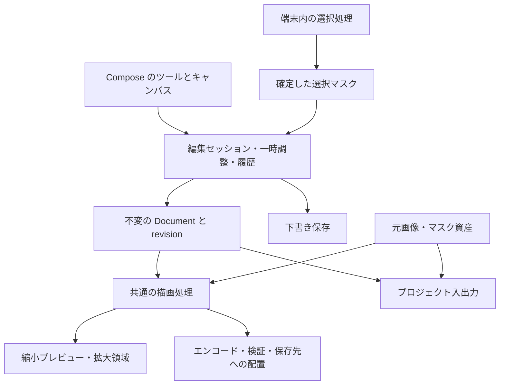

# Foldex 画像編集 — 商用品質に向けた実装設計案

作成: 2026-09-13 / 基準: Foldex 1.8.0、コミット `68f7e4e`

状態: **比較・設計。以下の追加機能は未実装。**
背景と不足一覧は [商用製品との比較](IMAGE-EDITOR-COMPARISON.md)。現在の実装と検証記録は [画像編集 1.8.0](IMAGE-EDITING.md)。

## 1. 目的と設計上の決定

写真・スクショの修正、目隠し、注釈、簡単な切り抜き合成、保存・共有前の最適化を、Foldex 内で完結させる。
初期の対象は静止画。既存の JPEG / PNG / WebP 出力を維持し、まず sRGB・8bit の見た目と透過を管理する。

- 既存の非破壊 `EditDocument`、`Layer`、プレビューと保存で共通の `DocumentRenderer` を育てる。
- 元素材は不変とし、編集指示、画像の書き出し、編集可能なプロジェクト保存を分ける。
- 選択結果は確定時に保持する。保存時に AI や色選択を再実行して範囲を変えない。
- 自動選択の結果を利用者が拡大して直せることを、AI モデルの大型化より先に整える。
- 画像と利用統計を送らない現在の方針を維持する。バッチ等の NAS 書き込みは利用者が指定した保存操作として扱う。
- Foldex 本体の MIT を維持する。依存の追加はユーザーの承認済み条件に沿って選定する。
- 設計のためにアプリの実装・依存・バージョンを変更しない。後続の実装は段階ごとに分ける。

### 既存設計との関係

元設計の非目的を勝手に実装済み・承認済みへ変更しない。今回の依頼に基づき、次の拡張を提案する。

| 従来の扱い | 今回の提案 |
|---|---|
| 画像エディタ v4: マジックワンド、v5: 複数レイヤー | 保存基盤の修正と選択ブラシを先行。色選択と合成は下記 CE1 / CE3 へ対応付ける |
| 色調補正は v6 以降に検討 | 日常用途の不足が大きいため、基本補正を CE2 に置く |
| シェイプ、レイヤーマスク、調整レイヤーは非目的 | 注釈用の単純な図形、切り抜き用マスク、再編集可能な補正を限定して追加提案 |
| 通常合成のみ | 初期 CE3 も通常合成。多数のブレンドモード・グループの入れ子は後続 |
| プレビュー 2048、出力長辺 8192 | 当面の上限を保ち、画素数・メモリ予算を追加。無条件の原寸出力へ広げない |
| 編集データに Bitmap を入れない | 維持。新しいマスクは不変のタイル資産を参照し、Undo ごとに画像を複製しない |

上表は計画変更の提案であり、以前のフェーズ完了を宣言するものではない。

## 2. 段階と完了条件

CE はこの提案内の順序であり、既存のリポジトリ P1〜P8 やアプリのバージョン番号とは別。
作業量は相対評価。端末・画像セットによる計測前なので日数は確約しない。

| 段階 | 利用者に届く結果 | 主な実装 | 前提 | 作業量 |
|---|---|---|---|---|
| CE0 品質基盤 | 失敗で原本を失わない。中断から再開できる | 出力処理分離、素材欠落エラー、メモリ予算、容量判定、下書き | 1.8.0 | 大。小さな 4 単位に分割 |
| CE1 選択・目隠し | 塗って範囲を直し、対象を隠す | 選択ブラシ、境界拡縮、マスク資産、効果の再調整、目隠しブラシ | CE0 | 大 |
| CE2 日常の補正・注釈 | 明暗・色・傾きとスクショの説明を整える | 基本補正、水平補正、自由色・スポイト、矢印・枠・文字改善、前後比較 | CE0。部分補正は CE1 | 中〜大 |
| CE3 切り抜き・合成・再編集 | 背景を替え、素材や文字を後から動かす | 複数素材、レイヤーパネル、画像マスク、プロジェクトの入出力 | CE0・CE1、CE2 の座標変換 | 大 |
| CE4 一括処理・出荷評価 | 複数画像を同じ設定で書き出す | 保存プリセット、バッチ、共有、端末群での品質評価 | CE0、対象の CE1〜CE3 機能 | 中〜大 |
| CE5 専門機能 | 写真・商品制作の対応範囲を広げる | 髪の高度な境界処理、修復、遠近、顔/OCR、RAW/HDR、巨大画像 | 各機能の評価・採用判断 | 個別調査 |

**最初の実装単位は CE0-A（保存の原本保護と、描けない画像の出力停止）。** 機能名を増やす前に、日常利用の土台を固める。
各段階で下の受け入れ条件を満たす。CE4 で初めて実機確認するのではなく、各段階で実施し、CE4 は通しの出荷評価とする。

## 3. 編集データと責務



### Document の拡張案

以下はデータ契約の案。新しいクラスはまず app の imageedit 内に置き、新規モジュールや横方向の依存を作らない。

| 型・責務 | 保持するもの・契約 |
|---|---|
| `DocumentSnapshot` | `schemaVersion`、`documentId`、単調増加 `revision`、キャンバス、レイヤー、目隠し、出力設定、素材表。Bitmap と実行中 Job を含めない |
| `SourceAsset` | 安定 ID、アプリ内素材の相対名、SHA-256、寸法、正規化前の向き、色の情報。元 URI は書き出し先候補として別保持 |
| `LayerNode` | 安定 ID、種類、名前、表示、ロック、不透明度、変換。画像・線・文字・図形・調整を順序付きに保持 |
| `MaskRef` | 不変マスク ID、幅高さ、座標系、画素への変換、タイル一覧。選択の生成方法と確定結果を分離 |
| `AdjustmentSpec` | 補正パラメータ、対象、任意の `MaskRef`。初期は補正レイヤーより下の合成に適用。画像単位の補正は対象を明示 |
| `RedactionSpec` | モザイク／不透明塗り、確定した範囲、粒度、色、追従する画像 ID またはキャンバスへの固定。新規の目隠しは最終合成へ適用 |
| `EditorSessionState` | activeLayer、ツール、表示ズーム、作業中のスライダー／ジェスチャー、保存状態。確定データと分離 |
| `RenderResult` | 成功、素材欠落、デコード失敗、メモリ予算超過、未対応処理。成功時だけ Bitmap の所有権を返す |
| `ExportOutcome` | 完了、条件未達、失敗、結果未確認、取消。保存先・実容量・メタデータ結果を保持 |

`DocumentSnapshot` は最初は既存 `EditDocument` を包む永続化用 DTO とする。`LayerNode` は既存 `Layer` の共通属性を段階的に拡張するための設計名であり、別の編集モデルを並行して増やす意図ではない。
初回スキーマには現在の全 Layer と SelectionSpec を明示的に記録する。新しい型を追加するときに schemaVersion と描画の互換性を更新する。

### 画面構成

上部は戻る・Undo / Redo・保存を維持し、キャンバスを中心に置く。下部のツールを「選択・目隠し」「調整」「注釈」「切り抜き・サイズ」「レイヤー」の用途でまとめる。
選択中のツールだけ設定を表示し、数値入力と「適用／取消」の位置を統一する。保存は画像を書き出す操作と編集データを保存する操作を区別する。
横画面・広い画面では設定を側面へ置き、48dp 以上の操作領域、読み上げ名、ドラッグ以外の調整操作を用意する。機能追加のたびに横長のツール列だけを伸ばさない。

### 既存コードの変更箇所

基準ディレクトリ: `/home/orgson/tmp_folder/3/13_Zero-to-Ship/app_project/04_foldex/app/src/main/kotlin/com/zerotoship/foldex/ui/imageedit/`

| 既存の責務 | 変更内容 | 段階 |
|---|---|---|
| `ImageEditViewModel` | 保存・素材・下書きを専用クラスへ委譲し、編集状態と操作の受付を中心にする | CE0 |
| `ImageSource` / `DocumentRenderer` | 失敗型、Bitmap 貸し出し、予算、描画順を共通化 | CE0、CE1〜CE3 |
| `ImageEncoder` / `ExifTransfer` / `SaveDialog` | 容量・メタデータの最終結果、保存先、透過の案内を接続 | CE0、CE4 |
| `EditDocument` / `EditHistory` / `Layer` | DTO、revision、マスク参照、新しい効果と素材の保持 | CE0〜CE3 |
| `SelectionSpec` / `ObjectSelectionEngine` / `SelectionPanel` | マスク資産、ブラシ修正、確定結果の再利用 | CE1 |
| `EditCanvas` / `CanvasTransforms` / `SelectionCoordinates` | 同じ行列で描画・hit test・選択・保存を対応付ける | CE1〜CE3 |
| `ImageEditScreen` / `TextPanel` / `BrushPanel` | 一時調整と確定、用途別のツール、新しい文字・色・注釈操作 | CE1〜CE3 |
| `ImageEditActivity` | 下書き復元、保存先の結果、画像出力後に編集を続ける導線 | CE0、CE3 |

### 操作・履歴・非同期処理

1. `BeginEdit` で基準 revision を取り、一時変更をプレビューする。
2. `CommitEdit` で 1 操作を履歴へ積む。スライダー移動や文字の 1 打鍵ごとには積まない。適用は 1 手、取消は 0 手。
3. Undo / Redo 後も revision は進める。履歴上の古い revision を再利用せず、実行中の推論・描画・容量見積もりを無効にする。
4. 計算結果は documentId・revision・処理 ID が一致するときだけ採用する。エラーとキャンセルで元の編集状態を壊さない。
5. 既存の 50 手は維持しつつ、マスクや長い線を含む履歴の参照資産量にも上限を設ける。新しい操作で Redo を破棄しても、現在の描画が参照する資産は直ちに消さない。
6. 書き出し中の編集禁止は当面維持。取消は配置の確定前まで。確定処理に入ったら完了／失敗を確定させ、CancellationException を一般エラーへ潰さない。

## 4. CE0 — 品質基盤

### CE0-A: 保存と描画の失敗を正しく扱う

`ImageEditViewModel.performSave/deliver` を `ImageExportCoordinator` と保存先別 `ExportTarget` へ分ける。
既存の `StorageProvider` を利用するが、`rename()` が存在するだけで原子的な置換を保証できるとは扱わない。

```text
不変の編集スナップショット
 → 素材・出力寸法・空き容量・保存先を確認
 → 共通レンダラー
 → 出力専用の一時ファイル
 → メタデータ方針を反映
 → 形式・寸法・デコード可能性・最終容量を確認
 → 出力先へ準備
 → 出力先の方式で確定
 → 結果と保存 URI を返す
```

| 保存先 | 原本保護と確定方法 |
|---|---|
| ローカル実パス | 同一ディレクトリに一意な一時ファイルを作り、書き込み・同期・検証後に置換。検証済みの原子的置換が利用できない場合は新規名で保存する。別名保存は既存名を排他的に避ける |
| SAF | `ACTION_CREATE_DOCUMENT` で別名出力を実装。URI を返す保存先選択を正規の入力とする。任意の Provider の既存ファイル置換を安全とは仮定しない |
| SMB / SFTP / FTP / WebDAV | 出力先内の一時名へ書き込み、close・内容確認後に確定。対象サーバーで置換の保証を検証できた経路だけ上書きを提供。その他は新規名保存を基本とする |

リモートは送信終了後に応答を失う場合がある。「結果未確認」を失敗と区別し、再確認・別名保存へ進める。再試行時に原本を削除したり、同じ出力を無制限に増やしたりしない。
上書き前には開いた時点の更新識別子と現在の保存先を照合する。ETag 等の条件付き更新がない経路では、検査と配置の間の競合を完全には排除できないため、共有先の厳密な原本保護は別名保存で満たす。
出力内容の照合は、サーバーが提供する検証可能なハッシュ、または読み戻しのハッシュを使う。サイズ一致だけを内容一致と扱わない。読み戻しの転送量と時間も保存の計測に含める。
エディタに必要な保存能力はまず app 側のアダプターで保守的に扱う。共有 `StorageProvider` の契約を広げる場合は別の変更単位とし、各ストレージ実装の振る舞いを確認する。

SAF の新規文書作成は保存先選択に使え、既存ファイルを上書きしない。[Android の文書アクセス](https://developer.android.com/training/data-storage/shared/documents-files)
内部の下書きファイルには AtomicFile を利用できるが、同時アクセスの排他は別途必要。[AtomicFile](https://developer.android.com/reference/android/util/AtomicFile)

素材欠落・デコード失敗・不正寸法は `RenderResult` の失敗へ伝播させる。空のレイヤーとして黙って描画を続けない。撮影情報の保持に失敗したときも成功表示だけで終わらせず、出力自体とメタデータ結果を分ける。

受け入れ条件:

- ローカルの書き込み途中、close、検証、置換直前に失敗を注入しても、原本のハッシュが変わらない。
- 素材削除・権限失効・破損ファイルを与えたとき、不完全な画像を保存成功にしない。
- リモート切断時に原本を残す。結果未確認では再接続して照合するか、利用者が別名出力を選べる。
- 保存先のキャンセル、同名競合、形式変更と拡張子／MIME、SAF の別名出力を確認する。

### CE0-B: メモリ予算と描画の所有権

`RenderBudget` は、出力、デコード中の画像、変形の中間画像、レイヤー用バッファ、マスク、推論、表示中プレビューを含めて見積もる。
単純な `width × height × 4` は 1 枚分であり、アプリ全体の必要量ではない。
利用可能なヒープと端末クラスに余裕を残す計算にし、実機で係数を決める。予算を超えるときは処理前に出力寸法を提示し、利用者の指定を黙って下げない。

- `ImageSource` の貸し出しと解放を維持し、終了後に小さいキャッシュへ置換する明示 API を追加する。
- 描画・保存・容量見積もり・AI の重い処理は、同じ予算の予約を取る。複数 Activity でも予約量が重ならない管理にする。
- 容量見積もりは出力 Bitmap を同時に複数持たず、CountingOutputStream または一時ファイルで計測する。古い計測結果は revision で破棄する。
- プレビューは通常縮小し、100% での確認には表示領域の詳細描画を後続追加する。
- タイル描画を入れても、標準の Bitmap エンコードが最終画像全体を要求する問題は残る。8192 超の原寸出力は領域デコード・タイル合成・逐次エンコードをまとめて検証する CE5 の課題とする。

Android もデコード前の寸法確認と用途に合う縮小読み込みを説明している。[大きい Bitmap の読み込み](https://developer.android.com/topic/performance/graphics/load-bitmap)

受け入れ条件: 12MP・48MP・8192 正方形・極端な縦長・大きい透過 PNG で、対応寸法で完了するか、原本と下書きを残したまま縮小を案内する。推論・容量見積もり・保存の連続操作後にキャッシュが予算内へ戻る。

### CE0-C: 容量・透過・メタデータの出力契約

- 目標容量はメタデータ反映後のファイル全体で判定する。品質探索に成功しても最終容量を再確認する。
- 指定容量に届かない場合は「推奨寸法へ縮小」「指定容量を外す」を出す。最低品質の大きすぎる出力を達成扱いにしない。
- PNG のように品質では縮まない場合は寸法で提案する。再エンコードの単調性だけに成功判定を依存しない。
- 透過は `Opaque / HasAlpha / Unknown` と合成範囲で管理し、Unknown は必要な検査を行う。JPEG の背景色を選べるようにする。
- メタデータは「撮影情報を保持」「位置情報を除く」「共有用に不要情報を除く」を出力方針として保持する。従来の GPS 保持の既定値は維持し、共有用プリセットは選択して使う。
- EXIF orientation は画素へ反映して正規化。入力の ICC を出力へ無条件コピーしない。まず sRGB 出力を統一し、広色域・HDR 入力の変換可否を明示する。

受け入れ条件: 不可能な小容量、GPS あり、透過あり／なし、形式変更で、画素・拡張子・MIME・実容量・メタデータ結果が保存画面の約束と合う。

### CE0-D: 下書きと素材の保存

`ImageDraftStore` を追加し、アプリ内部の永続領域に `documentId` 単位で保存する。OS が回収する cacheDir だけに復元を依存させない。
素材は編集開始時に不変のコピーとして確保し、ハッシュで同じ資産を参照する。コピーできない場合は永続下書き未保存を明示し、既存の保存先を変更しない。

- 確定操作ごとにバックグラウンド保存を予約。短い連続操作をまとめ、まず 1 秒程度のデバウンスを候補に実機で調整する。
- マスク／素材を先に永続化し、その後に manifest の世代を確定。1 つ前の正常な manifest を保持する。
- 各 document の書き込みは直列化。最後に永続化した revision だけを「下書き保存済み」とする。
- 復元は最後の保存済み操作まで。書き込み中の操作が必ず残るとは表示しない。復元後の Undo は新たに開始し、初期版では過去 50 手の永続化を約束しない。
- 戻る操作は「下書きを残す／破棄」の意図を扱う。画像の書き出し成功とプロジェクト削除を連動させない。
- 下書きの一覧・削除・使用容量を提供する。利用中の資産を削除せず、孤立した一時資産だけを回収する。元写真を含む下書きは通常の共有画像へ混ぜない。

受け入れ条件: 画面再生成、プロセス終了、保存途中の終了、素材の元ファイル移動、低空き容量で、最後の正常な下書きを復元できる。破損した最新 manifest は旧世代へ戻し、素材不一致は誤った画像を表示せずに伝える。

## 5. CE1 — 選択と目隠し

### 選択マスク

既存の `SelectionSpec` の幾何図形と二値輪郭を維持し、ブラシで修正する段階でラスターマスクへ変換できるようにする。
`AlphaMask` は 0〜255 の濃度を持ち、例えば 512×512 のタイルを不変資産として保存する。1 タイルは非圧縮 256 KiB。
編集で変えたタイルのみ新 ID を割り当て、履歴は ID を参照する。タイル寸法・ディスク予算は CE0 の計測で決める。

- 座標は素材ローカル／キャンバスを明示。マスクから素材／キャンバスへの変換行列を保存し、ズーム表示の座標を記録しない。
- 追加・除外の被覆率は `add = max(a,b)`、`subtract = a×(1-b)`、交差は `a×b`、反転は `1-a` として仕様化する（a,b は 0〜1）。
- 膨張・収縮・境界ぼかしは非破壊パラメータ。論理 px で保存し、出力倍率に応じて計算する。
- MagicTouch の確率は「選択の確かさ」で、髪の物理的な透過率ではない。確率をそのまま高品質な切り抜き alpha と呼ばない。まず現状の二値結果と手動修正を確実にする。
- 高度な境界推定では、前景・背景・不明領域の指定と、背景色のにじみの処理を別途評価する。単なる Feather で髪の品質が完成したとは扱わない。
- マジックワンドは範囲限定の flood fill、許容差、隣接のみを初期仕様とする。結果を確定して保存し、画像出力時の再探索を行わない。

### 操作

「人物・物」→タップ→「足す／引く」ブラシ→境界を確認→「モザイク／塗りつぶして隠す／切り抜き」へ進む。
ブラシ中は指で対象を隠しにくい拡大表示、色付きオーバーレイ、白／黒／市松の確認背景を用意する。
2 本指のズームと 1 本指の編集を分け、数値入力やボタンでも範囲調整できるようにする。

### 目隠しの描画規則

- 新規の `RedactionSpec` は合成の最後に描き、後から補正や画像追加をしても同じ対象を隠す。プレビューも同じ順序にする。
- モザイクの格子はキャンバス原点を基準に固定し、粒度と範囲を後から選んで変更できるようにする。
- 画像から作った目隠しは、その画像の素材座標と ID に結び付けて移動・回転へ追従させる。合成全体をなぞった目隠しはキャンバス固定とし、画像を動かしたときにも追従すると誤表示しない。画像削除時は関連する目隠しも同じ操作で削除し、Undo で一緒に戻す。
- 目隠し用マスクは境界ぼかしを使わず、必要な余白を追加できるようにする。不透明塗りは対象内部を alpha 255 で置換する。柔らかい選択からの変換は非ゼロの範囲を包含する方向で二値化し、適用前に範囲を表示する。
- モザイクやぼかしは、文字等が判別不能になる保証として案内しない。確実に画素を覆う用途には不透明塗りを用意する。
- 既存 `Layer.Mosaic` / `Fill(CLEAR)` の順序依存の意味を維持する。勝手に最終目隠し／画像マスクへ変換しない。新しい操作の追加時だけ上記の契約を使う。

受け入れ条件: 追加・除外・穴・離れた対象・細線・キャンバス端を、回転・切り抜き・リサイズ・再読込後も保持する。適用／取消／Undo が操作単位で働き、保存結果に同じ範囲が現れる。既存モザイクの 1.8.0 と新しい目隠しで、既存文書の描画を変えない。

## 6. CE2 — 日常の写真補正と注釈

### 補正

初期パラメータは明るさ、コントラスト、彩度、色温度。次に露出、ハイライト、シャドウ、シャープ、通常のぼかしを追加する。
パラメータを `AdjustmentSpec` として保存し、「適用」は履歴 1 手、再度開いて変更できるようにする。
全体補正を先に実装し、CE1 のマスクを利用する部分補正へ拡張する。

補正の順序、sRGB と計算用の線形 RGB の変換、透明画素の扱いをアルゴリズム単位で固定する。既定値で入力画素が変わらないことを条件とする。
プレビュー用だけ別の GPU フィルターを使う構成は避け、同じ定義を解像度に応じて評価する。GPU 化する場合は CPU の基準結果との許容差を測る。

### 変形と座標

`CanvasTransforms` と現在の 90° 前提の逆変換を、素材→キャンバス→画面／出力の行列に整理する。
水平補正では回転角と切り抜き枠を別保持し、「内側へ切り抜く／余白を残す」をプレビューで選べるようにする。
選択や目隠しの範囲もキャンバス変換を通す。合成へ進む前に、画像の回転とキャンバス全体の回転を別操作として定義する。
既存の縦横比固定と三分割グリッドは再利用する。リサイズには幅／高さ入力と比率ロックを追加し、切り抜き後の出力寸法を数値で確認できるようにする。

### 注釈と文字

- 矢印・矩形・楕円・番号を `ShapeLayer` として保存。移動、サイズ、色、線幅を変更できる。
- 自由色は RGB / HEX 入力とスポイトを用意。スポイトの取得対象は表示中の合成結果と明示する。
- 文字に揃え、行間、背景色、不透明度を追加し、キャンバス上の文字をタップして選べるようにする。
- 日本語の複数行、絵文字、長文、フォント欠落を確認する。外部フォントは最初から大量同梱せず、必要時にライセンスと再現性を確認する。
- 「元画像を表示」は押している間の比較と固定切替を提供。元画像の表示中に編集指示を追加しない。

受け入れ条件: 未調整時の一致、グレースケールと透過縁の補正、順序を入れ替えた結果、回転後の選択位置、ドラッグの取消、文字の再編集、200% 文字設定と TalkBack の操作を確認する。

## 7. CE3 — 切り抜き合成とプロジェクト

### 複数素材とレイヤー

単一 `sourceResolver` を `SourceRegistry` に置き換える。元 URI を失っても下書き内の素材から再開できる。
レイヤーパネルは行形式でサムネイル、名前、表示、ロックを表示。選択・並び替え・複製・削除・不透明度を操作できる。
移動ツールは最前面から hit test し、ロック中のレイヤーは除く。ブラシの描画先はアクティブな Drawing とし、意図せず過去の線の層へ追記しない。

切り抜きは画像レイヤーに `MaskRef` を付ける。マスクを戻す操作は原画を再表示するもので、生成による補完とは分ける。
画像とマスクの変換は初期版では連動。背景色・背景画像を下に置き、通常合成で成立させる。
消しゴムは描画レイヤーの線、画像マスクの修正は画像の見える範囲、と対象を操作画面に表示する。

### プロジェクト形式案

拡張子案は `.foldexedit`。ZIP コンテナ内に以下を保存する。PSD の読み書きは初期要件に含めない。

```text
manifest.json       schemaVersion / documentId / layers / masks / assets / output
sources/<id>        不変の素材。形式と SHA-256 は manifest に記載
masks/<id>/<tile>   確定したマスクのタイル
preview.png        編集後サムネイル
```

- app 内で明示 DTO を使う。初期の JSON は既存手段／Android 標準を利用できるため、設計時点でライブラリ追加を必須にしない。
- バージョン不明、未知の効果、欠落素材は通知し、読み飛ばして違う絵を上書きしない。変換時は元プロジェクトを残す。
- 外部ファイルの読み込みは展開総量、エントリ数、画像寸法、パストラバーサル、リンク、ハッシュを確認する。
- フォント非同梱の場合は書体 ID と代替表示を記録。端末間で完全一致しない可能性を検出し、黙って書き換えない。
- `.foldexedit` には目隠し前の元画像も含まれる。通常の「画像を共有」は平坦化した JPEG / PNG / WebP のみを使い、プロジェクトの共有は別操作とする。

受け入れ条件: 画像 3 枚＋文字＋切り抜き＋目隠しを保存し、再起動後に個別に再編集できる。プロジェクトの往復で幾何・マスク・補正値が一致する。破損・古い形式・未知の効果を安全に扱い、公開画像に元素材やプロジェクトを含めない。

## 8. CE4 — バッチ・保存プリセット・共有

ファイル一覧の複数選択から「画像を一括加工」へ入り、長辺／形式／品質／容量／メタデータ／保存先のプリセットを適用する。
初期は縮小・形式変換・メタデータの処理に限定し、画像ごとの AI 選択や修復は自動一括処理に含めない。

- 既存 WorkManager を利用候補とし、ジョブには素材参照と設定 ID を渡す。Bitmap や巨大な JSON をジョブ入力に入れない。
- 一覧・進捗・成功／失敗／スキップ／結果未確認を個別に保持。再試行は未完了だけとし、出力の重複を検出する。
- 初期の重い処理は 1 枚ずつ。並列数はメモリ予算と保存先に応じて後で増やす。
- バッチは別フォルダ／別名保存を既定にし、原本をまとめて上書きする機能は初期に含めない。
- 共有は確定済みの一時出力 URI を Android の共有先へ渡す。編集データを削除せず、他アプリへ渡す前に出力成功を確認する。

受け入れ条件: 100 枚の混在形式、途中キャンセル、低空き容量、ネットワーク切断、プロセス終了からの再試行で、原本・成功済み出力を維持し、各画像の結果が分かる。

## 9. 依存部品の方針

| 対象 | 初期設計で使うもの | 追加が必要になった場合 |
|---|---|---|
| UI・履歴・描画・基本補正・注釈 | 既存 Compose / Kotlin / Android Canvas | まず追加なしで成立させ、実測した不足で判断 |
| 自動選択 | 既存 LiteRT 1.4.2 + MagicTouch revision 1 | モデルのコードと重み両方のライセンス、速度、メモリ、精度を比較 |
| 下書き・マスク・プロジェクト | 内部ファイル、AtomicFile、明示 DTO、標準 ZIP | JSON ライブラリ等の採用は将来の保守負担とサイズから判断 |
| 保存・バックグラウンド処理 | 既存 StorageProvider / WorkManager | 新しいモジュール依存を必要条件にしない |
| 高度な境界・修復・顔/OCR・RAW | 初期段階では未選定 | 商用配布条件、モデル重みの再配布、対応 ABI、サイズ、通信の有無を候補ごとに確認 |

ユーザーの「ライセンスが変わらないなら追加して問題ありません」を適用する。Foldex 本体を MIT のまま配布できる部品を選び、第三者コードを MIT に書き換えない。
Apache 2.0 の部品は必要なライセンス・変更表示・告知を保持する。[Apache 2.0 の再配布条件](https://www.apache.org/licenses/LICENSE-2.0#redistribution)
追加部品は推移依存とモデルの条件も確認する。非商用限定、重みの再配布禁止、本体のライセンス変更が必要な候補は、この計画では採用しない。

## 10. 検証と出荷判断

比較先との同等精度・同等速度は未測定。以下は**検証計画と暫定目標**であり、達成済みの数値ではない。

| 領域 | 方法と受け入れ基準 |
|---|---|
| 基本ロジック | 既存 92 件を維持。座標往復、マスク集合演算、履歴、世代管理、DTO の移行を JVM で確認 |
| 原本保護 | 書き込み各段階へ失敗を注入し、原本ハッシュと結果の状態を確認。結果未確認のリモートは再接続して照合 |
| 描画 | 小さい合成画像で色・alpha・穴・効果順・モザイク格子を確認。文字は端末差を考慮し、全画素完全一致だけを判定に使わない |
| 選択品質 | 利用許諾を確認した 60 枚程度を初期セットにする。人物・髪・動物・商品・細線・低コントラスト等を含め、輪郭と修正に要した操作を評価。領域 IoU だけで髪の品質を判定しない |
| 操作時間 | 代表端末の 12MP 写真で、通常のプレビュー更新は p95 200ms 以内、タップ選択は初回 3 秒／連続 2 秒以内を仮目標。満たせなければ対象端末・モデル・表示方式を見直す |
| キャンセル | UI は取消をすぐ受理し、古い結果を表示しない。ネイティブ推論が即中断できない場合も同時実行を増やさず、処理終了後に資産を解放 |
| メモリ・負荷 | 実行ピークと完了後の保持量を測る。定義した端末群で OOM / ANR なし。大きすぎる画像は予算判定で案内し、未保存の編集を失わない |
| 端末・OS | minSdk 26、利用者の主端末、現行の配布対象 OS、4GB 級と 8GB 以上、16KB ページ端末を評価。32bit を配布する場合は 32bit でも予算を確認 |
| 保存先 | ローカル、SAF、利用対象の SMB / SFTP / FTP / WebDAV サーバーで、成功・権限失効・切断・名前競合を確認 |
| 操作性 | タッチ・マウス、縦横画面、TalkBack、200% 文字、日英、狭い画面で選択・修正・保存まで完了する |
| 実作業 | スクショへの目隠しと矢印、写真の補正、商品の切り抜きと背景、下書き復元、NAS への書き出しを通しで評価 |

商用出荷の最低条件は、原本破損・誤った範囲の保存・未通知の容量超過・編集データの消失という重大な未解決問題がないこと、対象端末と保存先で上記の実作業が成立すること。
商用アプリを用いた同条件の操作比較は、実装の各段階で代表画像を揃えて行う。公式ヘルプに機能があるだけでは同等品質と判断しない。

## 11. 次の作業へ渡す単位

1. **CE0-A**: `RenderResult` と出力コーディネーターを導入。素材欠落と保存中断のテストを先に用意し、原本保護の保存経路を実装。
2. **CE0-B/C**: キャッシュ縮小、重い処理の予算と直列化、目標容量とメタデータの結果通知。
3. **CE0-D**: 不変の素材と下書きスキーマ。既存文書を保存・復元するところまで完成させる。
4. **CE1**: 既存選択からマスク資産へ接続し、選択ブラシと目隠しの再調整を実装。
5. **CE2〜CE4**: 上の順で、一つの利用場面を完結させてから次へ進む。

今回の変更は文書のみ。実コード、依存、versionName / versionCode は変更していない。**ビルド未検証（文書変更のためビルドは対象外）**。既存 1.8.0 のビルド成功記録と、実機未検証の状態は変更しない。
