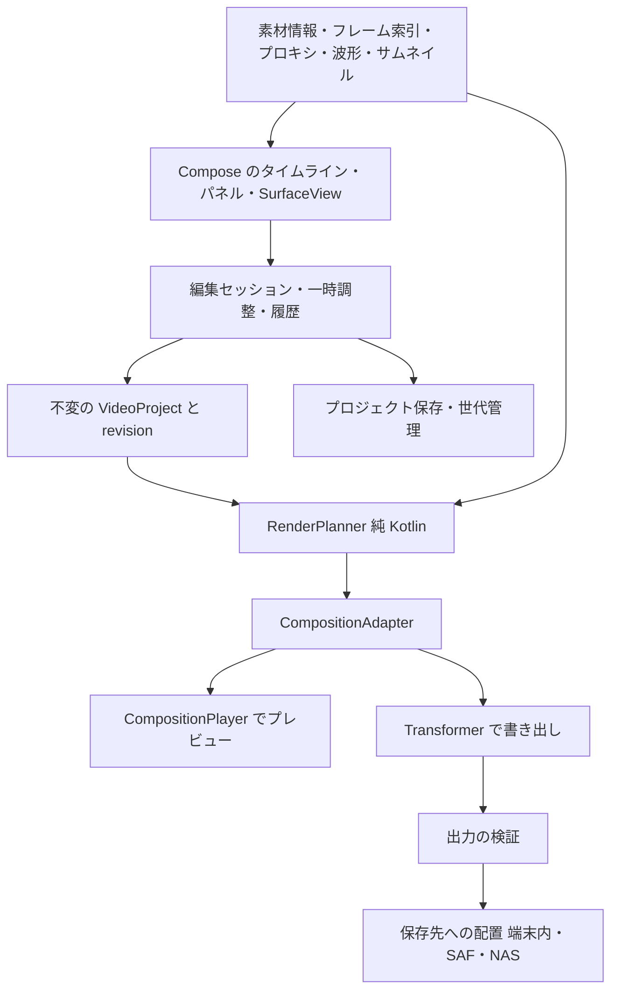

# Foldex 動画編集 — 商用品質に向けた実装設計案

作成: 2026-09-14 / 基準: Foldex 1.9.1、コミット `988e673`

目的: **商用アプリと同等の機能・品質を目指す。商用出荷は目的にしない。**
ライセンス: **Foldex 本体は MIT のまま。MIT より強い条件へ引き上げる部品は採用しない。**（2026-09-14 ユーザー指示）

状態: **画面・書き出し・下書きを実装し、実機の操作を改善中。** 段階別の実装と検証の履歴は以下を参照。
2026-09-14 追記: ユーザーの依頼で、画面だけの試作を追加した (1.10.0 / code 98、ビルド未検証)。依存と Media3 は変更していない。音声の再生・保存・書き出しは未実装。[試作の記録](VIDEO-EDITING-UI-1.10.0.md)。VE0 以降は引き続き §15 の回答後に着手する。
2026-09-15 追記: §15 の 6 件すべてに回答があった（compileSdk 36 と Media3 1.11.1、部品の追加、診断データは既存分も停止、主な用途は SNS 向けの縦動画、NAS の素材は端末へコピーしてから編集、仕様書 §10 に追記）。
用途の回答により、VE1 の後は縦動画に効くもの（文字の見た目と出入り、クリップの位置・拡大の調整、ぼかし背景）を VE2・VE3 から前倒しする候補にする。順序は VE1 の完了時に改めて確認する。
診断データの停止 (1.10.1)、VE0-A の依存の更新 (1.10.2)、VE0-C の描画計画と VE0-D の書き出しの基盤 (1.11.0)、VE0-C のプロジェクトの保存と下書きの一覧 (1.12.0) を実装した。いずれもビルド未検証。VE0-B の技術検証は未着手。[書き出しの記録](VIDEO-EDITING-EXPORT-1.11.0.md) / [下書きの記録](VIDEO-EDITING-DRAFTS-1.12.0.md)。
2026-09-16 追記: 1.12.0 の通常版ビルド・Lint・JVMテスト304件が成功し、moto g66j 5Gへ導入。
実機の報告を受け、左トリム・クリップ移動・使用区間の移動・吸着・分割表示を1.12.1で改善した。
[操作と検証の記録](VIDEO-EDITING-TIMELINE-1.12.1.md)。
1.13.0で動画・画像レイヤーの追加・配置・独立した時間編集・保存・書き出し計画を実装。
[レイヤーの操作と検証](VIDEO-EDITING-LAYERS-1.13.0.md)。ビルド・JVM・実機合成2件と1.13.0の更新インストールは完了。実機操作8件とVE0-Bの残りは未完了。
2026-10-01 追記: 1.14.0 / code 105 で音声付きの編集プレビューと基本操作を改善した。
`CompositionPlayer` と書き出しは同じ `RenderPlanner` / `CompositionAdapter` を使用し、区間・速度・音量・フェード・文字・映像レイヤーを反映する。
プレビューは720相当の描画サイズで、再生位置はプレイヤーから取得する。ドラッグ中の構成変更は180ms待ち、最新の編集だけ読み直す。
画面が裏に回ったときと書き出し中は再生を止め、デコーダを解放する。プレビュー失敗時は静止画で編集を続け、画面から再試行できる。
Media3 1.11.1 の内部プレイヤーには診断停止の引数がないため、プレビュー専用 Context で MediaMetrics サービスを渡さず、既存の診断停止方針を維持する。

通常の横ドラッグは時間移動、長押しまたは「移動」モードでクリップを移動する。
音声や文字の時間が重なる場合は別の段に表示し、各クリップを独立して選択できる。連続する字幕など、重ならない区間は同じ段を使い、ドラッグ中は段の配置を固定する。
「吸着」の切替、拡大・縮小・全体表示、タイムラインを広げる操作、切れ目の前後へ移動、クリップの先頭・最終コマへ移動、タイムコードまたは秒数を入力して移動を追加した。
選択中にも素材追加の入口を固定表示し、素材の種類に合う編集項目だけを出す。
再生位置より前・後のトリム、文字の分割、映像レイヤーの回転・反転に対応する。
選択外のメインクリップを分割する不具合を修正し、トリム・分割は選択した区間内で1コマ以上残せるときだけ有効にした。
音声の仮の波形を廃止し、表示位置に近い原本のPCMから50msごとのピークを取得する。10秒単位、1デコーダ、96区間のキャッシュで読み込みを制限し、未読・取得できない区間に架空の波形を描かない。

ビルド・テストの詳細と実機確認の結果は非公開の `PHASES.md` に記録する。
実フレーム索引、プロキシ、素材再リンク、端末ごとの多層再生性能の測定、切り替え効果、色調整、キーフレームは引き続き残る。
この版の基本操作改善だけで、商用製品との機能・速度・操作感が同等になったとは扱わない。

1.14.1 / code 106 では「時間指定」パネルを追加した。字幕・音声・映像レイヤーの配置の開始、全クリップの長さ、動画・音声の素材の開始/終了を、秒数または画面と同じタイムコードで入力できる。
入力欄は元のマイクロ秒を保持し、範囲外の入力は適用せず、指定できる範囲を表示する。
長さや素材区間を変えても配置の開始位置は固定し、速度を反映して素材の区間を換算、フェードは新しい長さへ収める。メインを短くした後の前詰めと、独立した音声・字幕・レイヤーの位置を変えない既存の規則を維持する。
メインの順番を前/後へ動かす操作と、独立した段を再生位置から始める操作を追加した。選択クリップや設定パネルを変えたときは操作列とパネルのスクロール位置を戻す。
色の選択は48dpのタッチ範囲と選択状態の読み上げに対応する。実機のタッチ操作の確認は、ユーザーの回答に基づき後日とする。

2026-10-02 追記: 1.14.2 / code 107 で、編集画面を開いたときにクラッシュする映像の再描画要求を削除した。
使用中の Media3 1.11.1 の `MultipleInputVideoGraph.redraw()` は未対応で例外を投げる。
`experimentalRedrawLastFrame()` はその処理を再生スレッドへ送るため、画面側で例外を捕捉しても防げない。
Surface の接続・サイズ更新には `setVideoSurface()` を使い、不要な再描画キャッシュの指定も削除した。
接続解除も、引数なしの `clearVideoSurface()` から対象の Surface を渡す呼び出しへ修正した。この版の `CompositionPlayer` は接続中の Surface との一致を要求し、引数なしでは画面の再生成や編集に伴う解除時に例外になる。
単独動画と映像レイヤーの実フレームを確認し、初期化後の再接続・サイズ変更・シーク・バックグラウンドからの復帰を調べる実機用の回帰テストを追加した。
その後、moto g66j 5G の既存クラッシュログでも、再描画要求と Surface 解除の例外を確認した。
1.14.2 を更新インストールし、動画の「編集」から編集画面と実映像を表示できることを確認した。

1.14.3 / code 108 では、実機確認で見つかったシーク後の映像停止と画面復帰・繰り返し再生の不具合も修正した。
単独動画は既定の単一入力グラフを使い、映像レイヤーがあるときだけ複数入力グラフを使う。
Media3 1.11.1 の複数入力グラフはシーク時の合成器の状態を残すため、位置・構成変更時にグラフを作り直す。
レイヤーのドラッグ中は120ms待ち、最新位置だけ反映する。画面が裏に回ったときはプレイヤーを解放し、復帰時は保持した位置から準備する。
繰り返し再生も先頭から新しいグラフで始め、解放済みプレイヤーの通知で状態を戻さない。
実機では単独動画・レイヤー合成の実画素、Surface の再接続・サイズ変更、前後へのシーク、スクラブ、画面復帰、レイヤーの追加・削除、繰り返し再生を確認した。

背景と不足一覧は [商用製品との比較](VIDEO-EDITOR-COMPARISON.md)。静止画は [画像編集の実装設計](IMAGE-EDITOR-ROADMAP.md)。

## 0. 要点

- 書き出しは Media3 Transformer、プレビューは Media3 CompositionPlayer を使う。どちらも Android 公式の Apache 2.0 の部品で、既存の動画プレーヤー（ExoPlayer）と同じ系統。
- その上に Foldex 独自の**非破壊タイムライン**を置く。タイムライン → 描画計画（純 Kotlin の `RenderPlan`）→ Media3 の `Composition` の二段で変換し、プレビューと書き出しで同じ計画を使う。
- 最初に使える形（VE1）は「複数の動画を切って繋ぎ、音量を整え、比率と容量を指定して書き出す」。そこから音声・文字（VE2）、重ね合わせと表現（VE3）、効率化（VE4）へ進む。
- 着手前に決めること: compileSdk 36 と Media3 1.11.1 への更新、部品の追加、診断データの扱い、用途の優先順位（§15）。

| 用語 | 意味 |
|---|---|
| クリップ | タイムラインに置いた素材の一区間 |
| トラック | クリップを並べる段。メイン（映像の主軸）、重ね（映像・画像・文字）、音声 |
| キーフレーム | 時刻ごとに値（位置・音量など）を指定し、その間を自動で補間する仕組み |
| プロキシ | 編集中の再生だけに使う軽い代替ファイル。書き出しは常に元の素材から行う |
| コーデック | 映像・音声の圧縮方式（H.264、HEVC、AAC など） |
| 再エンコード | 映像を一度展開して圧縮し直すこと。自由に加工できるが、時間がかかり画質はわずかに落ちる |
| 無劣化カット | 再エンコードせずに切り出すこと。画質は落ちないが、切れ目は素材のキーフレーム単位になる |
| VFR | 可変フレームレート。スマホの動画や画面録画に多く、コマの間隔が一定でない |

## 1. 目的と設計上の決定

利用場面の仮定: スマホで撮った動画・画面録画を、切る／繋ぐ／BGM と字幕を付ける／縦横を変える／容量を落とす、をして保存・共有・NAS へ送る。

| # | 決定 | 理由 |
|---|---|---|
| 1 | **非破壊編集**。素材は変更せず、編集は値（データ）として持つ | 画像編集と同じ。Undo が軽く、何度直しても劣化しない。途中保存と再開がそのまま作れる |
| 2 | **プレビューと書き出しは同じ `RenderPlan` から作る** | 分けると「プレビューと結果が違う」不具合が必ず出る（画像編集の設計と同じ教訓） |
| 3 | **原本を上書きしない保存を既定**にし、出力を検証してから配置する | 数 GB の書き出しの失敗で原本を失うと取り返しがつかない。画像編集 CE0-A の契約を踏襲 |
| 4 | **時刻はマイクロ秒の整数、fps は有理数**で持つ。浮動小数の秒は使わない | 29.97fps（30000/1001）や長時間の素材で誤差が積もり、音ずれ・1 コマずれの原因になる |
| 5 | **端末内の素材は参照、SAF とリモートの素材は取り込む**（§10） | 数 GB のコピーを避ける。一方でネットワーク越しの編集は遅く、切断に弱い |
| 6 | **端末内で完結し、利用統計を送らない**。Media3 の診断データ送信は止める（§9） | 画像編集の方針と PRIVACY.md に揃える |
| 7 | **Foldex 本体は MIT のまま**。部品は Apache 2.0 / BSD / MIT などの許容型に限る。GPL / LGPL / AGPL / MPL の部品、非商用限定・再配布禁止のモデルは採用しない | ユーザー指示。Apache 2.0 の部品はライセンス文と告知を同梱し、本体の MIT は変えない |
| 8 | **新しい Gradle モジュールは作らず** `app/.../ui/videoedit/` に置く。`model/` と `plan/` は Android 非依存 | 画像編集と同じ判断。モジュール間の依存を増やさない。純 Kotlin の部分は JVM テストできる |
| 9 | 画像編集の `EditDocument` とは**別のモデル**にする。保存先の確定方法・下書きの世代管理・結果未確認の扱いは同じ規則にする | 時間軸の有無で構造が根本的に違う。画像エディタ設計の「動画編集は別の世界」を維持 |
| 10 | 段階ごとに「使える状態」で止め、実機で確認してから次へ進む | 1 日 1〜3 時間の作業で、未完成の状態を長く抱えない |

### 既存仕様との関係

非公開の仕様書（FOLDEX-HANDOFF.md §10）では当初、動画は「サムネイルとメタデータのみ内蔵、それ以外は外部アプリ」としていた。
その後、再生は P7 で、画像編集は 1.2.0 で内蔵しており、方針はすでに部分的に更新されている。
**動画編集の内蔵は新しい範囲の追加であり、本書は提案。** 仕様書の更新はユーザーの確認後に行う（§15-6）。

## 2. 技術選定

### 2-1. 方式の比較

| 方式 | 長所 | 短所 | 判断 |
|---|---|---|---|
| Media3 Transformer + CompositionPlayer | Android 公式、Apache 2.0。既存の ExoPlayer と同系統。ハードウェアの符号化・復号（MediaCodec）と GPU（OpenGL）で処理。複数シーケンスの合成、音声のミックス、速度変更、HDR→SDR 変換、MP4 の書き込みを内蔵 | プレビューの CompositionPlayer は実験的 API（`@ExperimentalApi`）。クロスフェード等の切り替え効果は標準で非対応。端末ごとのコーデック差の影響を受ける。1.10 以降は compileSdk 36 が必須 | **採用（推奨）**。足りない部分は独自の効果・合成処理で補う |
| MediaCodec + OpenGL + MediaMuxer を直接使う | 完全に制御できる | 端末差の回避策、音ずれ防止、音声ミックス、HDR をすべて自作する。工数が最大 | 不採用。Media3 で足りない箇所だけ同じ仕組みで足す |
| FFmpeg 系のライブラリ | 読める形式が広く、フィルタが豊富 | LGPL / GPL の条件があり §1-7 の方針に反する。ABI ごとのネイティブビルド、APK の増加、ソフトウェア処理による遅さと発熱 | **採用しない** |

### 2-2. Media3 の版と compileSdk

Maven の AAR に含まれるメタデータ（`minCompileSdk`）と、GitHub のソースで確認した（2026-09-14）。

| 版 | 必要な compileSdk | 動画編集に関わる点 |
|---|---|---|
| 1.4.1（現在） | — | transformer / effect / muxer は未導入 |
| 1.9.3 | 35 | compileSdk 35 のまま使える最後の系列。`setSpeed(SpeedProvider)`、CompositionPlayer（スクラブ、最後のフレームの再描画、複数入力）はある。`setSpeed(SpeedParameters)` はない |
| 1.10.x | 36 | — |
| **1.11.1（最新、2026-09-10）** | **36** | `EditedMediaItem.Builder.setSpeed(SpeedParameters)` がある。フレーム抽出は `media3-inspector-frame` の `FrameExtractor` |

**推奨: compileSdk を 36 へ上げ、Media3 を 1.11.1 に揃える。** targetSdk 35 と minSdk 26 は変えない。

- CompositionPlayer は実験的 API で、変更と修正が速い。古い系列に留まると、後で修正を取り込むときに版上げと編集機能の変更が混ざる。
- この端末の SDK には `android-36` と build-tools 36.0.0 が入っている（確認済み）。CI での SDK の用意は VE0-A で確認する。
- 既存の動画・音声プレーヤーも 1.11.1 に上がるため、版上げは編集機能と別の変更単位（VE0-A）にして再生の回帰を確認する。

追加する部品（すべて Apache 2.0、同じ版に揃える）: `media3-transformer`、`media3-effect`、`media3-muxer`、`media3-inspector-frame`。
既存の `media3-exoplayer`、`media3-ui`、`media3-session` も同じ版へ上げる。APK の増加量は VE0-A で計測する。

### 2-3. 使う API（1.11.1 のソースで存在を確認）

| 用途 | API |
|---|---|
| 書き出し | `Transformer.start(Composition, path)`、`getProgress(ProgressHolder)`、`cancel()`、`resume(Composition, outputFilePath, oldFilePath)` |
| 構成 | `Composition.Builder`：`setVideoCompositorSettings`、`setEffects`、`setHdrMode`、`setTransmuxAudio` / `setTransmuxVideo` |
| 段（シーケンス） | `EditedMediaItemSequence.withAudioAndVideoFrom` / `withVideoFrom` / `withAudioFrom`、`Builder.addGap(durationUs)`、`setIsLooping` |
| クリップ | `EditedMediaItem.Builder`：`setEffects`、`setSpeed(SpeedProvider)` / `setSpeed(SpeedParameters)`、`setRemoveAudio`、`setRemoveVideo`、`setDurationUs`、`setFrameRate`、`setFlattenForSlowMotion`。区間は `MediaItem.ClippingConfiguration` |
| 重ね合わせ | `VideoCompositorSettings.getOverlaySettings(inputId, presentationTimeUs)`（時刻ごとに配置を返せる）、`getOutputSize(inputSizes)` |
| 時間で変わる効果 | `GlMatrixTransformation.getGlMatrixArray(presentationTimeUs)`、`RgbMatrix.getMatrix(presentationTimeUs, useHdr)`、`TextOverlay.getText(presentationTimeUs)`、`BitmapOverlay.getBitmap(presentationTimeUs)` / `getOverlaySettings(presentationTimeUs)` |
| 標準の効果 | `Presentation`、`Crop`、`ScaleAndRotateTransformation`、`Brightness`、`Contrast`、`HslAdjustment`、`RgbAdjustment`、`RgbFilter`、`SingleColorLut.createFromCube` / `createFromBitmap`、`GaussianBlur`、`AlphaScale`、`OverlayEffect`、`TextOverlay`、`BitmapOverlay`、`CanvasOverlay`、`DrawableOverlay`、`FrameDropEffect`、`ThumbnailStripEffect` |
| プレビュー | `CompositionPlayer`：`setComposition(composition, startPositionMs)`、`setScrubbingModeEnabled`、`experimentalRedrawLastFrame()`、`setVideoSurface(Surface, Size)` |
| 高速トリム | `Transformer.Builder.experimentalSetTrimOptimizationEnabled` |
| その他 | `Transformer.Builder`：`setEncoderFactory`、`setMaxDelayBetweenMuxerSamplesMs`、`setEnsureFileStartsOnVideoFrameEnabled`、`setUsePlatformDiagnostics` |

### 2-4. 設計を縛る Media3 の制約

ソースの説明と公式ガイドから拾ったもの。これを前提に変換計画を作る。

| 制約 | 設計への影響 |
|---|---|
| 出力は映像 1 本・音声 1 本まで | 複数の音声トラックは書き出し時にミックスする。音声を別トラックで出力する機能は作らない |
| シーケンスが HDR 素材で始まると、後続も HDR である必要がある | HDR と SDR が混ざるときは、既定で全体を SDR に変換する |
| 音声を含む全アイテムは、同じチャンネル数の 16bit PCM に揃える必要がある | 変換計画で各クリップに `ToInt16PcmAudioProcessor` と `ChannelMixingAudioProcessor` を必ず付ける |
| 縦長の出力は、互換性のため幅と高さを入れ替えて符号化される | 出力の検証は画素の寸法ではなく「表示される向き」で判定する |
| `resume` は単一シーケンス・MP4・速度変更なしのときだけ。高速化の最適化は再開時に効かない | 中断からの再開は約束しない。条件を満たす単純な書き出しだけで使う |
| CompositionPlayer：速度変更はクリップの最初の効果のみ、全アイテムに長さが必要、`REPEAT_MODE_ONE` 不可、単一スレッドから操作 | 変換計画で効果の順序と長さを必ず決める。操作はメインスレッドに集める |
| CompositionPlayer の出力先は SurfaceView / SurfaceHolder / `setVideoSurface`。TextureView は不可 | プレビューは SurfaceView。操作用のハンドルは Compose で上に重ねる |
| 公式ガイドは、Composition がクロスフェードに対応していないと明記 | 切り替え効果は A/B ロール（§5-3）で自作する |
| トリムの高速化は単一の MP4 素材で、効果なし（90° 回転のみ可）に限られる。MP4 の edit list によるトリムは、切ったはずの部分がファイルに残るとガイドが注意している | 高速トリムは「無劣化カット」の限られた場面だけで使う。**edit list のトリムは使わない** |

## 3. 全体構成



Media3 の型を扱うのは `engine/` だけにする。`model/` と `plan/` は Media3 を知らない。
Media3 の実験的 API が変わっても、直すのは `engine/` の変換部分に閉じる。

### ファイル構成

```
app/src/main/kotlin/com/zerotoship/foldex/ui/videoedit/
├── VideoEditActivity.kt        # 起動・素材の受け取り・保存先の選択
├── VideoEditScreen.kt          # 画面全体
├── VideoEditViewModel.kt       # プロジェクトの保持・操作の受付・履歴
├── timeline/
│   ├── TimelineView.kt         # Canvas 描画。見えている範囲だけ描く
│   ├── TimelineGestures.kt     # スクロール・ズーム・トリム・移動
│   └── TimelineLayout.kt       # 時刻と画面座標の変換（純計算）
├── panel/                      # 分割・速度・音量・文字・変形・色・書き出しの各パネル
├── model/                      # ★ Android 非依存。JVM テストを書く場所
│   ├── VideoProject.kt / Track.kt / Clip.kt
│   ├── TimeUs.kt / FrameRate.kt          # 整数マイクロ秒と有理数 fps
│   ├── Keyframes.kt / Easing.kt
│   ├── SpeedSpec.kt / Transition.kt / TextSpec.kt
│   ├── EditOps.kt                        # 分割・トリム・前詰め・移動などの編集操作
│   └── ProjectHistory.kt                 # Undo / Redo
├── plan/                       # ★ Android 非依存
│   ├── RenderPlan.kt / RenderPlanner.kt  # VideoProject → RenderPlan
│   ├── AbRollAssigner.kt                 # 切り替え効果の段の割り当て
│   ├── SpeedMapping.kt                   # 素材の時刻 ↔ タイムラインの時刻
│   ├── GainCurve.kt                      # 音量・フェード・ダッキング
│   └── LoudnessMeter.kt                  # 音の大きさの測定（ITU-R BS.1770）
├── engine/                     # Media3 / MediaCodec に依存。UI には依存しない
│   ├── CompositionAdapter.kt             # RenderPlan → Composition
│   ├── PreviewController.kt              # CompositionPlayer の管理
│   ├── ExportCoordinator.kt / OutputVerifier.kt
│   ├── DeviceCapabilities.kt             # 符号化・復号の能力
│   ├── MediaProbe.kt / FrameIndexer.kt   # 素材の情報と実際のフレーム時刻
│   ├── ProxyGenerator.kt / WaveformExtractor.kt / ThumbnailCache.kt
│   ├── VideoWorkGate.kt                  # 重い処理の優先順位と直列化
│   └── effect/                           # 独自の効果（キーフレーム変形・色・クロマキー・マスク・音量曲線）
├── project/
│   ├── VideoProjectStore.kt / ProjectCodec.kt
│   └── AssetLocator.kt                   # 素材の照合と再リンク
└── service/
    └── VideoExportService.kt             # 書き出し中の前景サービス
```

## 4. データモデル

```kotlin
/** 画素・Bitmap・Media3 の型を含めない。コピーが軽く、Undo と保存にそのまま使える。 */
data class VideoProject(
    val schemaVersion: Int,
    val projectId: String,
    val revision: Long,                     // 確定操作ごとに単調増加。古い計算結果の破棄に使う
    val settings: ProjectSettings,
    val assets: Map<AssetId, MediaAsset>,
    val mainTrack: List<MainClip>,          // 前詰め。映像の主軸
    val layers: List<LayerTrack>,           // 重ねる映像・画像・文字。下 → 上
    val audioTracks: List<AudioTrack>,
    val captions: CaptionTrack?,
    val markers: List<Marker>,
    val export: ExportSettings,
)

data class ProjectSettings(
    val canvas: CanvasSize,                 // 1920×1080 / 1080×1920 / 1080×1080 / 1080×1350 など
    val frameRate: FrameRate,               // 有理数。コマへの吸着と書き出しの fps
    val background: Background,             // 単色。ぼかし背景は VE3
    val dynamicRange: DynamicRangePolicy,   // SDR に変換（既定） / HDR を保持（対応端末のみ）
    val audio: AudioFormatSpec,             // 48kHz・2ch・16bit に統一
)

data class MediaAsset(
    val id: AssetId,
    val kind: AssetKind,                    // VIDEO / AUDIO / IMAGE
    val location: AssetLocation,            // 端末内パス / SAF URI / 取り込み済み（アプリ内）
    val origin: String?,                    // 元の FileUri（NAS など）。書き出し先の候補
    val fingerprint: AssetFingerprint,      // サイズ + 更新時刻 + 先頭と末尾 4MiB の SHA-256
    val probe: MediaProbeResult,            // 長さ・寸法・回転・fps・VFR か・色空間/HDR・音声の ch と周波数・コーデック
)

data class MainClip(
    val id: ClipId,
    val assetId: AssetId,
    val source: SourceRange,                // 素材の開始・終了。素材の実際のフレーム時刻へ吸着済み
    val speed: SpeedSpec,                   // Constant(rate, keepPitch) / Curve(points)
    val video: VideoProps,                  // 変形（キーフレーム）・切り抜き・反転・補正・効果
    val audio: AudioProps,                  // 音量（キーフレーム）・フェード・ミュート・分離済みか
    val transitionIn: Transition?,          // 直前のクリップとの切り替え効果
)

data class LayerClip(
    val id: ClipId,
    val start: TimeUs,                      // タイムライン上の絶対時刻
    val content: LayerContent,              // Media / Image / Text / Shape
    val video: VideoProps,
    val audio: AudioProps?,
)

/** 時刻はクリップ内の相対時刻。空 = 既定値、1 点 = 固定値。 */
data class Keyframes<T>(val points: List<Keyframe<T>>)
data class Keyframe<T>(val time: TimeUs, val value: T, val easing: Easing)   // LINEAR / EASE_IN_OUT / HOLD / BEZIER
```

### 規則

- **時刻**: 整数のマイクロ秒（`TimeUs`）。fps は有理数（例 30000/1001）。タイムライン上の位置はプロジェクトのコマの格子へ、素材の開始・終了は**素材の実際のフレーム時刻**（§6-4 のフレーム索引）へ吸着する。VFR の素材でも、指定したコマで切れる。
- **座標**: キャンバスに対する正規化座標（0〜1）。プロキシ・プレビューの寸法・書き出しの寸法が違っても同じ値を使える。
- **速度**: タイムライン上の長さ = 素材の各区間の長さ ÷ その区間の速度、の合計。
  例: 10 秒の素材で、0〜4 秒を 1 倍、4〜6 秒を 0.5 倍、6〜10 秒を 1 倍にすると、4 + 4 + 4 = **12 秒**。一定の 2 倍なら 5 秒。
  速度カーブは 1 コマ以下の間隔の一定速度の区間に分けて Media3 の `SpeedProvider` に渡す。
- **キーフレームの補間**: 純 Kotlin で計算し、効果は描画時刻で値を読む。例: 不透明度 0 秒で 0%、1 秒で 100%、直線補間なら 0.25 秒で 25%。
- **切り替え効果**: 直前のクリップの末尾と、次のクリップの先頭を重ねる。長さ 1 秒なら全体が 1 秒短くなる（一般的な編集ソフトと同じ）。素材の余り（開始前・終了後の部分）が足りない場合は、効果の長さを自動で縮めて表示する。
- **文字**: 文字列・書体 ID・キャンバスの高さに対する大きさ・色・縁取り・背景・揃え・動きのプリセットを持つ。書体は当面、端末標準のみ。
- **ID と revision**: 画像編集と同じ。ID は保存後も変えない。計算結果は revision が一致するときだけ採用する。

### 履歴

- 確定操作ごとに `VideoProject` を丸ごと履歴に積む。プロジェクトは数十 KB 程度のデータで、画素を含まない。上限は 100 手。
- スライダーのドラッグ中・文字の 1 打鍵ごとには積まない。指を離した時点・「適用」で 1 手。
- 画像編集と同じく、Undo の過去履歴は保存しない（再開後の Undo は新しく始まる）。

## 5. 変換: VideoProject → RenderPlan → Composition

### 5-1. 二段にする理由

`RenderPlan` は「どの素材のどの区間を、どの段の何秒目に、どの効果で置くか」を純 Kotlin の値で表したもの。

- 変換の正しさ（長さ、隙間の位置、段の割り当て、速度の区間、キーフレームの標本）を **JVM テストで確かめられる**。Media3 を含むテストは端末が必要で遅い。
- Media3 の実験的 API が変わっても、`RenderPlan` から先の変換（`CompositionAdapter`）を直すだけで済む。
- プレビュー用（プロキシ、軽い設定）と書き出し用（元素材、符号化設定）の違いは、計画を作るときの引数だけにする。

### 5-2. 変換の手順

1. **素材の確認**: 見つからない・変更された・権限が無い素材があれば、計画を作らず失敗を返す。黒い画面や無音で黙って続けない。
2. **メイントラック**: 切り替え効果が無ければ、クリップを順に 1 つのシーケンスへ並べる。切り替え効果があれば §5-3。
3. **重ねる段**: 段ごとに 1 シーケンス。クリップの前は `addGap` で埋める。位置・拡大・回転・不透明度は `VideoCompositorSettings.getOverlaySettings(inputId, 時刻)` とクリップ単位の行列効果で表す。
4. **文字・図形**: 表示区間を持つ `BitmapOverlay` として合成全体の効果に置く。文字の見た目が変わったときだけ Bitmap を作り直し、動き（位置・不透明度）は時刻ごとの配置で表す。デコーダーを増やさない。
5. **音声**: 音声トラックごとにシーケンス。すべてのクリップに速度、音量の曲線、16bit PCM への変換、チャンネル数の統一を付ける。
6. **合成全体**: `Presentation` で出力寸法とはめ込み方、`setHdrMode` で HDR の扱い。
7. **書き出しだけ**: 符号化の設定、診断データの無効化（§9）。**プレビューだけ**: プロキシへの差し替え、実行時に変わるパラメータの受け口（§6-2）。

### 5-3. 切り替え効果（A/B ロール）

Media3 の Composition はクロスフェードに対応していないため、**重なる 2 つのクリップを別々のシーケンスに置き、合成時の不透明度を時刻で変える**。音声は両方の音量曲線を交差させる。

例: A（0〜10 秒）、B（10 秒の素材）、C（10 秒）。A→B に 1 秒のクロスフェード、B→C は切り替え効果なし。

| 方式 | 段 1 | 段 2 | 特徴 |
|---|---|---|---|
| 方式 1: 交互に置く | A（0〜10）、隙間（10〜19）、C（19〜29） | 隙間（0〜9）、B（9〜19） | 構成が単純。段の切り替わりでデコーダーが止まる・動く |
| 方式 2: 重なる部分だけ別の段 | A（0〜10）、B の 1〜10 秒（10〜19）、C（19〜29） | 隙間（0〜9）、B の 0〜1 秒（9〜10） | 主な映像が 1 段に収まる。B の途中の継ぎ目が 1 コマもずれず、音もつながることが条件 |

どちらを使うかは VE0-B の技術検証で決める。判定の基準は、継ぎ目のずれ（0 コマ）、プレビューのコマ落ち、書き出し速度。
暗転は黒の単色を挟み、スライドは時刻ごとの位置で表す。ワイプなど形のある切り替えは独自の合成処理が必要なため、VE3 以降に回す。

### 5-4. 技術検証で確かめる未確定事項

ソースと資料だけでは確定できず、実機で確かめてから実装に入るもの。

| # | 確かめること | 決まらないと困る箇所 |
|---|---|---|
| U1 | クリップ単位の効果と合成全体の効果に渡る `presentationTimeUs` の基準（クリップの先頭からか、全体の先頭からか） | キーフレーム、文字の表示区間 |
| U2 | 映像シーケンスの隙間の見え方（透明か黒か）と、合成での扱い | 重ねる段、A/B ロール |
| U3 | 主端末で同時に再生できる映像の段数（1080p の素材 / プロキシ） | 重ねる段の上限、プロキシの条件 |
| U4 | 44.1kHz と 48kHz の素材が混ざったときのミックス | 音声の統一処理 |
| U5 | 回転情報付きの縦動画と横動画の混在、縦長出力の向き | はめ込み、出力の検証 |
| U6 | MP4 に撮影日時・位置情報を書き込む手段 | 書き出しのメタデータ |
| U7 | `SpeedProvider` に渡る時刻の基準と、音程維持の範囲 | 速度変更 |
| U8 | 構成を変えたときの `setComposition` の再準備にかかる時間 | 編集後のプレビューの応答 |
| U9 | 診断データを止める方法の実効性（§9） | プライバシー方針 |

## 6. プレビュー

### 6-1. 表示

- `SurfaceView` を `AndroidView` で置き、選択中のレイヤーの枠とハンドルは Compose で重ねる。
- プレビューの内部解像度は表示領域に合わせる（例: 画面上 1080×608 なら、4K のキャンバスでも 1080p 相当で合成する）。書き出しとは寸法だけが違い、計画は同じ。

### 6-2. 操作ごとの反映方法

| 操作 | 反映方法 |
|---|---|
| 再生・停止・シーク | CompositionPlayer。ドラッグでの位置合わせ中は `setScrubbingModeEnabled(true)` |
| クリップ端のドラッグ（トリム） | 計画は作り直さない。フレーム索引とサムネイルのキャッシュから該当のコマを表示し、指を離したら新しい計画を `setComposition(計画, 位置)` |
| スライダー（色・音量・位置） | 効果が「実行時パラメータ」から値を読む。停止中は `experimentalRedrawLastFrame()` で再描画。確定時に計画を更新 |
| 構成の変更（追加・削除・並べ替え・分割） | 計画を作り直して `setComposition`。再生位置は変更前の内容の位置に合わせて保つ |

### 6-3. プロキシ

次のいずれかに当てはまる素材は、取り込み後にバックグラウンドで 720p・H.264 のプロキシを作り、プレビューだけで使う（条件は暫定。VE0-B で決める）。

- 長辺が 1920px を超える、fps が 60 を超える、HEVC 10bit / HDR、ビットレートが 30Mbps を超える
- 端末の能力判定で、必要な段数を実時間で復号できない

書き出しは常に元の素材から行う。座標が正規化されているので、プロキシへの差し替えで見た目の配置は変わらない。
プロキシのキーフレーム間隔は短くし（目安 0.5 秒）、位置合わせの応答を上げる。Transformer の符号化設定で指定できるかは VE0-B で確認する。

### 6-4. 素材の索引・サムネイル・波形

| キャッシュ | 作り方 | 用途 |
|---|---|---|
| フレーム索引 | MediaExtractor でサンプルを順に読み、表示時刻とキーフレームかどうかを記録（復号しない） | コマへの吸着、無劣化カットの切れ目 |
| サムネイル列 | `FrameExtractor` で表示倍率に応じた間隔のコマを取り出し、小さい JPEG でディスクに保存 | タイムラインのクリップ表示 |
| 波形 | MediaCodec で PCM に展開し、10ms ごとの最小・最大値をバイナリで保存 | 音声クリップの表示、ダッキングの材料 |

キーは素材の照合値（§10）と取り出し条件。素材が変わったら作り直す。すべて再生成できるので、容量が足りなければ消してよい。
1 時間・30fps の素材はサンプルが約 10 万 8 千個。MP4 は索引がファイル先頭付近にまとまっていて短時間で読めるが、MKV / WebM は全体を走査する場合がある。進捗を出し、編集は索引の完成を待たずに始められるようにする。

### 6-5. 重い処理の順番

`VideoWorkGate` で優先順位を付ける: プレビュー > サムネイル > 波形 > プロキシ。
**書き出しは排他**。開始時にプレビューのプレーヤーを解放してデコーダーを空け、終了後に戻す。端末のコーデックの同時使用数には上限があるため。

## 7. タイムライン UI

```
┌──────────────────────────────────────────┐
│ ←  旅行 2026-09          ↶ ↷     書き出し  │
├──────────────────────────────────────────┤
│                                          │
│              [ プレビュー ]               │  キャンバスの比率で表示
│         選択中のレイヤーの枠と操作点        │
│                                          │
├──────────────────────────────────────────┤
│ 00:01:23;14 / 00:04:10;00   ◀▮  ▶  ▮▶  ⤢ │  時刻・1 コマ戻る・再生・1 コマ進む・全体表示
├──────────────────────────────────────────┤
│ T ▭▭▭▭ タイトル        │                  │  重ねる段（あるときだけ表示）
│ ▣▣▣▣▣▣▣│▣▣▣▣▣▣▣▣▣▣│▣▣▣▣▣▣              │  メイン（サムネイル列）
│ ∿∿∿∿∿∿∿∿∿∿∿∿∿∿∿∿∿∿∿∿∿∿               │  音声（波形）
│                        ↑ 再生位置（中央固定）│
├──────────────────────────────────────────┤
│  分割   削除   速度   音量   変形   …       │  選択中のクリップの操作。未選択なら「追加」系
└──────────────────────────────────────────┘
```

### 操作の決まり

| 操作 | 動き |
|---|---|
| 1 本指の横ドラッグ | タイムラインのスクロール。再生位置は画面中央に固定し、分割は中央の線の位置で行う |
| 2 本指のピンチ（タイムライン上） | 時間軸のズーム。全体表示から、1 コマが指で触れる幅まで |
| 2 本指のピンチ・回転（プレビュー上） | 選択中のレイヤーの拡大・回転。未選択なら何もしない |
| クリップの両端 | トリム。吸着する位置（再生位置・他のクリップの端・マーカー）で軽い触覚 |
| 長押しして移動 | クリップの並べ替え（メイン）・位置の移動（重ねる段・音声） |
| タップ | クリップの選択 |

- **ドラッグ以外でも同じことができる**: ±1 コマ、時刻の数値入力、選択中クリップの開始・終了の数値指定、変形の数値パネル。TalkBack では「クリップ 3、12 秒から 18 秒、長さ 6 秒」のように読む。
- 操作領域は 48dp 以上。横画面・広い画面では操作パネルを右側に置く。
- 吸着は一時的に解除できる。
- **その段階で動かない機能を灰色で並べない**（画像編集と同じ規則）。
- 操作は用途でまとめる: 追加（動画・画像・音声・文字・録音）、編集（分割・削除・複製・差し替え・速度）、見た目（変形・切り抜き・補正・LUT・マスク・クロマキー）、音（音量・フェード・分離・ダッキング・音量の正規化）。

### 導線

| 入口 | 動き | 段階 |
|---|---|---|
| ビューア（動画）の右上「編集」 | その動画 1 本で新しいプロジェクト | VE1 |
| ファイル一覧の複数選択 →「動画編集で開く」 | 選んだ順に並べて新しいプロジェクト | VE1 |
| ホームの下書き一覧 | 動画プロジェクトを再開・削除・容量の確認 | VE1 |
| メディア横断ビューの複数選択 | 一覧からと同じ | VE4 |

画像編集では、編集が 1 枚単位のため複数選択からの入口を作らなかった。動画編集は複数の素材を並べるのが基本なので、複数選択からの入口を作る。

### 描画

- `TimelineView` は Canvas に、見えている時間の範囲だけを描く。クリップ数に比例した Composable を作らない。
- 時刻と画面座標の変換（`TimelineLayout`）は純計算にして JVM テストする。
- 200 クリップ・60 分のプロジェクトでもスクロールとズームが追従することを受け入れ条件にする。

## 8. 書き出し

### 8-1. 流れ

```text
不変のプロジェクト（revision を固定）
 → 素材の存在・照合値・権限を確認（欠落は開始前に止める）
 → 端末の能力で出力設定を検証（コーデック・解像度・fps・ビットレート・HDR）
 → 空き容量を見積もる（（映像 + 音声のビットレート）× 長さ × 1.1 + 余裕）
 → RenderPlan（書き出し用、元素材）
 → Transformer（診断データ無効）で一時ファイルへ
 → 出力を検証（トラック・形式・寸法・表示の向き・長さ・先頭/中間/末尾のコマの復号・音声の有無・容量）
 → 保存先の方式で配置
 → 結果: 完了 / 条件未達（要求と実際の差）/ 失敗 / 結果未確認 / 取消
```

### 8-2. 書き出しの設定

| プリセット | 既定の内容 | 主な用途 |
|---|---|---|
| 標準 | キャンバスの寸法、プロジェクトの fps、H.264、AAC 192kbps、MP4 | 共有・再生の互換性 |
| 高画質 | HEVC（対応端末）、高いビットレート | 保存用 |
| 容量指定 | 目標の容量から映像のビットレートを決める | NAS・メッセージでの送信 |
| 音声のみ | AAC（.m4a） | 録音・BGM の取り出し |
| 無劣化カット | 再エンコードなし。単一の素材を切るだけのプロジェクトに限る | 素早い切り出し |

- 解像度・fps・コーデックは、`MediaCodecList` の符号化能力（対応する寸法・fps・ビットレートの範囲、Android 10 以降は性能点）で**実現できるものだけ**を選択肢に出す。重い組み合わせには「時間がかかる可能性があります」と出す。
- 符号化の設定が端末に合わず Media3 が別の設定へ切り替えた場合（例: HEVC → H.264、4K → 1080p）、**成功扱いにせず「条件未達」として要求と実際を並べて表示**する。

### 8-3. 容量指定の計算

例: 目標 50MiB、長さ 3 分（180 秒）、音声 128kbps。

1. 全体のビットレート = 50 × 1,048,576 × 8 ÷ 180 ≒ 2,330kbps
2. 映像 = 2,330 − 128 − 容器の余裕（2% ≒ 47）≒ **2,155kbps**
3. 解像度ごとの下限（暫定: 1080p30 で 3,000kbps、720p30 で 1,500kbps。実機で校正）を下回るので、「720p にすると画質を保てます」と提案する
4. 書き出し後に実際の容量を測る。目標を超えたら、ビットレート ×（目標 ÷ 実際）× 0.95 で最大 2 回まで再試行する。それでも超えたら結果を示して、利用者に選んでもらう

画像編集の CE0-C と同じく、最低品質の大きすぎる出力を「達成」と扱わない。

### 8-4. 無劣化カット

- MediaExtractor で素材のサンプルを読み、開始位置の直前のキーフレームから終了位置までを、再エンコードせず MP4 に書き写す。
- 開始位置がキーフレームでない場合は「開始が 1.2 秒前のキーフレームにずれます」と事前に表示する。
- 「先頭だけ再エンコードして正確に切る」を選んだ場合は `experimentalSetTrimOptimizationEnabled` を使う（単一の MP4 素材・効果なしのときだけ）。
- **MP4 の edit list でのトリムは使わない**（切り取ったはずの映像がファイルに残る）。

### 8-5. 保存先

画像編集 CE0-A の規則を動画用に実装する。

| 保存先 | 方式 |
|---|---|
| 端末内（実パス） | 保存先フォルダ内の隠し一時名（`.foldex-<uuid>.mp4.part`）へ直接書き出す → 検証 → 新しい名前で確定。同じボリューム内なので数 GB のコピーが発生しない。上書きは既定にせず、選んだ場合も一時ファイル → 検証 → 置換 |
| SAF | アプリ内の一時ファイル → `ACTION_CREATE_DOCUMENT` の URI へ書き込む → 読み戻して長さとハッシュを照合 |
| NAS（SMB / SFTP / FTP / WebDAV） | アプリ内の一時ファイル → 保存先の一時名へ転送 → サイズとハッシュを照合 → 名前を確定。応答を失ったときは「結果未確認」として再照合を案内 |

- 出力のハッシュは書き出し後に 1 回だけ全体を計算する（1GB で数秒〜十数秒の見込み。VE0-D で計測）。
- 空き容量は、実際に書き込むボリューム（アプリ内の一時領域と保存先の両方）で確認する。

### 8-6. メタデータ

- 撮影日時: 最初のメインクリップの撮影日時、または書き出した時刻を選べるようにする。
- 位置情報: 画像編集と同じく「保持 / 除く」を選べる。保持する場合は最初のメインクリップの値を使う。書き込み手段は U6 で確認する。
- 回転: 出力は表示の向きで検証する（§2-4）。

### 8-7. 書き出し中の実行

- `VideoExportService` を前景サービスとして起動し、通知に進捗と取消を出す。完了通知から出力を開ける。
- 前景サービスの種別: Android 15 以降は `mediaProcessing`（1 日 6 時間までの共有枠。超過時の `onTimeout` で取り消し、プロジェクトは残して通知）。Android 14 以前は既存の `dataSync` を使う。マニフェストの宣言と実行時の切り替えは VE0-D で実機確認する。
- 書き出し中は部分 WakeLock を持つ（既存の `WAKE_LOCK` 権限）。
- 端末の温度状態（Android 10 以降の熱状態の通知）が高いときは知らせる。自動で止めることはしない。
- プロセスが終了した場合、次の起動時に一時ファイルを片付けて「前回の書き出しは完了していません」と表示し、最初から書き出し直せるようにする。`resume` は §2-4 の条件を満たすときだけ使う。

### 8-8. 失敗の分類

| 分類 | 利用者への案内 |
|---|---|
| 素材なし・変更・権限切れ | 再リンクか、素材を取り込み直す |
| 読めない形式（例: WMV） | 外部アプリで変換してから使う |
| デコーダー / エンコーダーの初期化失敗 | 解像度を下げる、H.264 にする、プロキシで試す |
| コーデックの資源不足 | 他のアプリを閉じる、重ねる段を減らす |
| 容量不足 | 必要な空き容量と、今の空き容量を表示 |
| 出力の検証失敗 | 出力を配置しない。原本とプロジェクトは無事と明示 |
| 保存先の失敗 / 結果未確認 | 再照合・別の場所へ保存 |
| 取消 | 一時ファイルを消す |

Media3 の `ExportException` のエラーコードをこの分類に対応付ける。対応表は VE0-D で作る。

## 9. 端末内完結と診断データ

Media3 の送信設定をソースで確認した（1.11.1、既存プレーヤーは 1.4.1）。

| 対象 | 既定 | 変更できるか |
|---|---|---|
| Transformer（書き出し） | `usePlatformDiagnostics = true`。Android 15 以降で編集の事象と性能を MediaMetricsManager へ渡す | `Transformer.Builder.setUsePlatformDiagnostics(false)` で止められる |
| ExoPlayer（既存の再生、1.4.1 / 1.11.1） | `usePlatformDiagnostics = true`。Android 12 以降で再生の事象と性能を渡す | `ExoPlayer.Builder.setUsePlatformDiagnostics(false)` で止められる |
| CompositionPlayer（プレビュー） | 内部で作る ExoPlayer に設定を渡していないため、既定の `true` のまま | CompositionPlayer.Builder に設定が無い（§9-1） |

Media3 の説明によると、これらのデータは端末の利用者が「使用状況と診断情報の共有」を有効にしている場合に Google が収集することがある。
Foldex 運営者へ送るものではないが、画像編集で統計送信を避けた判断と揃えて、**すべて止める**。

### 9-1. CompositionPlayer の対処案

ソースで確認した仕組み（1.11.1）:

- ExoPlayer は `MediaMetricsListener.create(context)` の中で `context.getSystemService(Context.MEDIA_METRICS_SERVICE)` を取得し、**null なら送信の仕組みを作らずに終わる**（`ExoPlayerImpl` の `Api31.registerMediaMetricsListener`）。
- CompositionPlayer は受け取った Context の `getApplicationContext()` を保持し、内部の ExoPlayer もさらに `getApplicationContext()` を通して上の処理に渡す。
- Transformer が素材の読み込みに内部で使う ExoPlayer は、`setUsePlatformDiagnostics(false)` が指定済み。

| 案 | 内容 | 評価 |
|---|---|---|
| A（第一候補） | `getApplicationContext()` で自分自身を返し、`getSystemService(MEDIA_METRICS_SERVICE)` だけ null を返す ContextWrapper を `CompositionPlayer.Builder` に渡す | Media3 を改変しない。ただし公開 API ではない内部の動きに頼るため、Media3 の版上げのたびに確認が必要 |
| B | Media3 に設定の追加を要望し、対応した版を待つ | 確実だが時期が読めない |
| C | 送信を許容し、PRIVACY.md に明記する | 画像編集の方針と揃わないため推奨しない |

U9 で確かめること: 案 A で Media3 のログ「MediaMetricsService unavailable.」が出ること。再生・シーク・音声フォーカス・イヤホンを抜いたときの停止に影響がないこと。
案 A が成立しない場合は、B と C のどちらにするかを改めて確認する。成立した場合も、Media3 の版上げ時の回帰テストに含める。

## 10. 素材の扱い

| 素材の場所 | 扱い | 理由 |
|---|---|---|
| 端末内（実パス） | コピーせず参照する。照合値で変更を検出 | 数 GB のコピーを避ける |
| SAF | 永続的な読み取り権限を取れれば参照。取れなければ容量を示して取り込む | 権限が再起動後に消える保存先がある |
| NAS（SMB / SFTP / FTP / WebDAV） | 編集前に端末内の「素材キャッシュ」へ取り込む（進捗・取消・空き容量の確認つき）。元の場所は書き出し先の候補として保持 | ネットワーク越しの細かいシークと長い書き出しは遅延・切断の影響が大きい。Media3 のガイドも、遅い回線では書き出しが途中で止まる場合があると説明している |
| 画像・音楽・字幕ファイル | プロジェクト内へコピー | 小さい。元の移動に影響されない |

- **照合値**: サイズ + 更新時刻 + 先頭と末尾 4MiB の SHA-256。画像編集の全体ハッシュは数 GB の動画では時間がかかるため使わない。完全な一致の保証ではなく、変更の検出が目的と明記する。
- **変更・移動の検出時**: 誤った映像で書き出さず、「素材が見つかりません / 変更されています」→ 再リンク（別の場所のファイルを指定、照合値と長さ・寸法で確認）か、そのまま閉じるを選ぶ。
- **読めない素材**: 取り込み時に先頭のコマの復号を試し、失敗したら理由（形式・コーデック）を出して追加しない。
- **容量の管理**: 下書き一覧に、素材キャッシュ・プロキシ・サムネイルと波形の容量を分けて表示し、削除できる。参照中の元ファイルは消さない。プロキシ等は削除しても再生成できる。
- **共有の区別**: プロジェクトは加工前の素材を参照・同梱する。書き出した動画の共有とプロジェクトの共有は別の操作にする（画像編集の `.foldexedit` と同じ規則）。

## 11. プロジェクトの保存と復元

- `VideoProjectStore`: `filesDir/videoedit/<projectId>/` に、schemaVersion 付きの manifest を二世代保持する。書き込みは直列化し、一時ファイル → sync → 置換。破損した最新世代は一つ前へ戻す（画像編集 CE0-D と同じ規則）。
- 確定操作の約 1 秒後と、画面が裏に回ったとき（ON_STOP）に保存する。「保存済み」は最後に書き込みが完了した revision だけに表示する。
- 形式は新規依存なしの明示形式にする（画像編集の下書きと同じ方針）。JSON にするかバイナリにするかは VE0-C で決める。
- 未知の schemaVersion・未知の効果・欠落した素材は通知し、読み飛ばして違う内容で上書きしない。
- 書き出しの実行状態（開始・一時ファイルの場所）も記録し、異常終了後に片付けられるようにする。
- プロジェクトの書き出し・読み込み（`.foldexvideo`、ZIP に manifest と必要な素材）は VE4。読み込み時は展開後の総量・エントリ数・パスの不正（`../`）・ハッシュを確認する。

## 12. 段階と完了条件

VE はこの提案内の順序で、リポジトリの P1〜P8 やアプリのバージョン番号とは別。
実装単位ごとに、先に `versionName` / `versionCode` を上げてからビルド・テスト・コミットする（CLAUDE.md §0-6）。
作業量は相対評価。端末と素材での計測前なので日数は約束しない。

| 段階 | 利用者に届く結果 | 主な実装 | 前提 | 作業量 |
|---|---|---|---|---|
| VE0 基盤と技術検証 | 動画 1 本を切って、原本を守りながら書き出せる | 依存更新、技術検証、モデルと計画、書き出し基盤 | 確認事項への回答 | 大。4 単位に分割 |
| VE1 カット編集 | 複数の動画を並べて切り、比率と容量を指定して書き出す | タイムライン、メイントラック、画像クリップ、音量とフェード、プリセット、無劣化カット、下書き | VE0 | 大 |
| VE2 音声・文字・切り替え | BGM・ナレーション・字幕・タイトルを付け、速度を変える | 音声トラック、波形、音量キーフレーム、ダッキング、正規化、録音、文字、字幕と SRT、一定速度、切り替え効果 | VE1 | 大 |
| VE3 重ね合わせと表現 | 映像や画像を重ねて動かし、色と見た目を整える | 重ねる段、キーフレームとイージング、色補正、LUT、ぼかし・モザイク、クロマキー、マスク、ぼかし背景、速度カーブ、逆再生 | VE2 | 大 |
| VE4 仕上げと効率 | 長い作業を安全に続け、同じ設定をまとめて使う | プロジェクトの保管、再リンク、プロキシ管理、マーカー、複数選択、属性のコピー、プリセット、一括変換・圧縮、静止画の書き出し | VE1〜VE3 の対象機能 | 中〜大 |
| VE5 専門機能 | 対応できる用途を広げる | 手ブレ補正、自動字幕、ノイズ除去、被写体の追従、背景除去、ブレンドモード、HDR の保持、GIF 書き出し | 候補ごとの評価と採用判断 | 個別調査 |

### VE0 — 基盤と技術検証

**VE0-A 依存の更新**
- 全 9 モジュールの compileSdk を 36 へ。Media3 を 1.11.1 へ上げ、transformer / effect / muxer / inspector-frame を追加。
- 既存の VideoViewer / AudioPlayer の診断データを止める（§15-3 の回答による）。
- 設定画面の第三者ライセンス表示に、追加した部品を載せる。
- 受け入れ条件: 既存の再生（端末内・NAS のストリーミング・シーク・再生エラー時の外部アプリ案内・音声）が変わらない。`:app:lintRelease` と `:app:assembleRelease` が成功する。APK の増加量を記録する。

**VE0-B 技術検証**
- デバッグビルドだけの検証画面、または実機テストで、§5-4 の U1〜U9 と次の数値を主端末（moto g66j 5G、Dimensity 7060、メモリ 8GB）で測る。
  - 1080p30 H.264 を 1 本書き出す速さ、4K HEVC 素材の書き出し
  - 映像 1〜4 段 + 音声 2 段のプレビューのコマ落ち
  - プロキシの生成速度、A/B ロールの方式 1 と 2 の比較
- 結果を文書に記録し、重ねる段の上限・プロキシの条件・切り替え効果の方式を決める。検証用のコードは利用者向けの画面に出さない。

**VE0-C モデルと計画**
- `model/` と `plan/` を実装し、JVM テストを書く（§13-1）。`VideoProjectStore` の世代管理まで。

**VE0-D 書き出しの基盤**
- `ExportCoordinator`、`OutputVerifier`、`VideoExportService`、保存先 3 種、失敗の分類、通知。
- 最小の画面（動画 1 本の開始・終了を数値で指定して書き出す）で通しを確認する。

VE0 の受け入れ条件: 動画 1 本を切って書き出したとき、原本のハッシュが変わらず、出力が検証を通る。書き出し中の取消・容量不足・素材の削除・NAS の切断・プロセスの終了で、原本とプロジェクトが残り、状態が正しく表示される。

### VE1 — カット編集（最初の実用版）

- 入口（§7 の導線）、プロジェクトの作成と下書き一覧。
- メイントラック: 並べ替え・トリム・分割・削除・複製・差し替え。画像クリップ（表示秒数の指定）。
- タイムライン: サムネイル列、中央固定の再生位置、吸着、±1 コマ、時刻の数値入力、ズーム。
- キャンバスの比率（16:9 / 9:16 / 1:1 / 4:5）、はめ込み／切り抜き、背景色。クリップの回転・反転・切り抜き。
- クリップの音量・ミュート・フェードイン／アウト。
- 書き出し: 標準・高画質・容量指定・音声のみ・無劣化カット。
- 素材の再リンク（最小版）。

受け入れ条件:
- VFR のスマホ動画・縦動画・画面録画・4K HEVC・44.1kHz と 48kHz が混ざったプロジェクトで、**指定したコマで切れる（誤差 0 コマ）**。
- 出力の長さがタイムラインの長さと 1 コマ以内で一致する。60 分の素材の末尾で、音と映像のずれが 1 コマ以内。
- 30 クリップの並べ替え・トリムで操作が指に追従し、Undo / Redo が操作単位で働く。
- 書き出した設定（寸法・fps・コーデック・容量）が表示どおり。違う場合は「条件未達」として表示される。
- 画面の再生成・プロセスの終了の後、最後に保存した操作まで復元できる。

### VE2 — 音声・文字・切り替え

- 音声トラック（BGM・効果音）、映像の音声を別クリップへ分離、波形表示。
- 音量のキーフレーム、ダッキング（声の段の音量から、BGM を下げるキーフレームを自動で作る。作った後に手で直せる）。
- 音量の正規化: ITU-R BS.1770 の積分ラウドネスを測り、目標（例: −14 LUFS / −16 LUFS / −23 LUFS）へ合わせる。書き出し時に音割れを防ぐリミッターを付ける。
- ナレーション録音（マイク権限 `RECORD_AUDIO` が必要。この段階で確認する）。
- 文字: タイトル・テロップ（書体・大きさ・色・縁取り・背景・揃え・出入りの動き）。日本語の複数行、絵文字、長い文を確認する。
- 字幕トラック: 時刻付きの字幕、SRT の読み込み（既存の文字コード判定を使う）と書き出し、動画への焼き込み。
- 速度: 一定速度（範囲は技術検証で決める。候補 0.1〜16 倍）、音程を保つかの選択。30fps 以下の素材を 0.5 倍より遅くするときは「なめらかにするには高 fps の素材が必要」と表示する。
- 切り替え効果: クロスフェード・暗転・スライド（§5-3）。

受け入れ条件: 切り替え効果の前後で映像が 1 コマも欠けず重複しない。音量の曲線がプレビューと書き出しで一致する。SRT の往復で時刻と文字が一致する。正規化の結果が目標から ±1 LU 以内。

### VE3 — 重ね合わせと表現

- 重ねる段（映像・画像・図形）、同時に表示できる数は VE0-B の上限に従う。超えるときは理由を示す。
- キーフレーム（位置・拡大・回転・不透明度・色補正の値）とイージング。
- 色補正: 露出・コントラスト・彩度・色温度・色かぶり・ハイライト・シャドウ。既定値で入力の画素が変わらないこと。
- LUT: `.cube` の読み込み（`SingleColorLut.createFromCube`）。サイズと値の範囲を検証する。
- ぼかし・モザイク: 範囲を指定し、キーフレームで動く対象に合わせる。画像編集と同じく、ぼかし・モザイクは判読不能の保証として案内せず、確実に隠す用途には不透明な塗りを用意する。
- クロマキー（色の指定・許容範囲・境界・色かぶり除去）、形のマスク（矩形・楕円、境界のぼかし）、ぼかし背景。
- 速度カーブ、逆再生（逆順の中間ファイルを作る。作成時間と容量を事前に表示）。
- プレビュー用の中間ファイル（重すぎる区間だけ書き出して差し替える）。

受け入れ条件: キーフレームの値がプレビューと書き出しで一致する（同じ時刻のコマで比較）。上限を超える構成で、黙って表示を欠かさない。

### VE4 — 仕上げと効率

- プロジェクトの書き出し・読み込み（`.foldexvideo`）、再リンクの完全版、プロキシの管理画面。
- マーカー、複数クリップの選択とまとめての移動、属性（色・音量・文字の書式）のコピーと貼り付け、書き出しプリセットの保存。
- 一括変換・圧縮: ファイル一覧の複数選択から、同じ設定で 1 本ずつ処理。各ファイルの成功・失敗・スキップを残し、未完了だけを再試行。別名・別フォルダへの保存が既定。
- 現在のコマを静止画として書き出し、画像エディタで開く。
- 候補: 同期ジョブの転送前の自動圧縮、EDL など他の編集ソフト向けの書き出し。

受け入れ条件: 20 本の混在形式の一括圧縮で、途中の取消・容量不足・プロセスの終了の後も、原本と成功済みの出力が残り、各ファイルの結果が分かる。

### VE5 — 専門機能（候補ごとに調査して採用を決める）

| 候補 | 調査の観点 |
|---|---|
| 手ブレ補正 | 端末内での処理時間、画質、ジャイロ情報の有無 |
| 自動字幕 | 端末内の音声認識の日本語精度・速度。モデルのライセンス（MIT 等）とサイズ。実行時のダウンロードをしない |
| ノイズ除去 | BSD / MIT 等の許容型の部品、処理時間 |
| 被写体の追従・背景除去 | 既存の MagicTouch は静止画 1 枚ずつ。動画のコマ間の一貫性と処理時間 |
| ブレンドモード | 独自の合成処理の実装量 |
| HDR の保持 | Android 13 以降の対応端末での HDR 書き出し、SDR との混在 |
| GIF 書き出し | Media3 に GIF の書き込みは無い。自作の符号化の品質と速度 |

すべて §1-7 のライセンス方針に合う部品だけを候補にする。

## 13. 検証と品質の評価

比較先との同等の速度・画質は未測定。以下は**検証計画と暫定の目標**であり、達成済みの数値ではない。

### 13-1. 自動テスト

| 種類 | 対象 | 確かめること |
|---|---|---|
| JVM | `TimeUs` / `FrameRate` | 29.97fps の長時間で誤差が積もらない、コマ番号 ↔ 時刻の往復 |
| JVM | `EditOps` | 分割・トリム・前詰め・移動の前後で合計の長さが合う、切り替え効果の余りが足りないときの短縮 |
| JVM | `SpeedMapping` | §4 の 12 秒の例、速度カーブの区間分割、往復変換 |
| JVM | `Keyframes` | 補間（直線・イーズ・固定）、範囲外、1 点だけ |
| JVM | `RenderPlanner` / `AbRollAssigner` | 隙間の位置、段の割り当て、全体の長さ、効果の順序（速度変更が先頭） |
| JVM | `LoudnessMeter` | 規格の試験信号（正弦波）での測定値 |
| JVM | `ProjectCodec` / 世代管理 | 往復、未知の schema、破損した最新世代から一つ前への復帰 |
| JVM | 字幕 | SRT の読み書きの往復、文字コード |
| 実機 | コマの精度 | コマ番号を画素の模様で埋め込んだ小さな試験動画（自作・数百 KB）を切って書き出し、出力のコマを復号して番号が一致するか |
| 実機 | 音と映像のずれ | 既知の時刻に「白いコマ」と「クリック音」を入れた試験動画で、書き出し後の差を測る |
| 実機 | 失敗の注入 | 書き出し中の取消、容量不足、素材の削除、SAF の権限失効、NAS の切断、プロセスの終了 |

### 13-2. 試験素材

- 主端末で撮影した 1080p30 / 60（VFR）、縦動画、回転情報付き
- 他の端末の 4K HEVC 10bit HLG、120 / 240fps のスロー（利用許諾を確認したもの）
- 画面録画（可変 fps、音声なし・内部音声あり）
- 44.1kHz / 48kHz、モノラル / ステレオ / 5.1ch
- MKV / WebM（VP9・AV1）、MOV
- 60 分以上・4GB 超
- 途中で切れた・壊れたファイル、音声のみ・映像のみ
- 画像（JPEG / PNG / 透過）、音楽（MP3 / AAC / FLAC / Opus）

### 13-3. 暫定の性能目標（主端末で計測）

| 項目 | 暫定目標 | 満たせない場合 |
|---|---|---|
| 1080p30 の 1 段のプレビュー | コマ落ち 1% 未満 | プロキシの条件を広げる |
| 1080p30 + 重ねる段 2 つ（プロキシ） | 30fps を維持 | 重ねる段の上限を下げる、中間ファイル |
| 停止中のシーク（プロキシ） | p95 で 300ms 以内に表示 | プロキシのキーフレーム間隔を短くする |
| 構成の変更後のプレビューの再開 | p95 で 500ms 以内（10 クリップ） | 変更の種類ごとに再構成を減らす |
| 1080p30 H.264 の単純なカットの書き出し | 実時間より速い | 設定の既定値を見直す |
| 60 分の素材の末尾の音ずれ | 1 コマ（約 33ms）以内 | 不具合として修正する |
| 出力の長さ | タイムラインと 1 コマ以内 | 不具合として修正する |

### 13-4. 端末・操作性・実作業

- 端末: moto g66j 5G（主端末）、メモリ 4GB 級の端末、HDR 撮影に対応した高性能端末。Android 8（minSdk 26）・10・12・13・15・16（エミュレーターを含む）、16KB ページの端末。
- 操作性: タッチ、縦横の画面、TalkBack、200% の文字、日本語と英語、狭い画面、片手操作。
- 実作業の通し評価:
  1. 旅行の動画 10 本を 3 分にまとめ、BGM と字幕を付けて書き出す
  2. 画面録画の不要な部分を切り、説明の文字を入れる
  3. 4K の動画を 1080p・容量指定で圧縮して NAS へ送る
  4. 横の動画を 9:16 の縦動画にする
  5. 作業の途中でアプリを終了し、再開して書き出す

商用アプリと同等の品質とみなす最低条件は、**原本の破損、指定と違うコマでの切断、音ずれ、黙って条件を満たさない出力、編集データの消失**がどれも無く、上の実作業が主端末で成立すること。
公式ページに機能があることだけで同等とは判断しない。代表の素材を揃えて、比較先と同じ操作を行う比較は各段階で実施する。

### 13-5. ビルドの扱い

この端末（z2term）上のビルドは利用者が行う運用のため、エージェントの作業単位は「ビルド未検証」として引き渡す場合がある。
その場合はコミットメッセージと記録に明記し、利用者またはデスクトップでのビルド・テストの成功を確認してから、段階の完了を判断する。

## 14. リスク

| リスク | 影響 | 対応 |
|---|---|---|
| CompositionPlayer が実験的 API | 版上げで API が変わる、複数段のプレビューの不具合 | Media3 の型を `engine/` に閉じ込め、`RenderPlan` を境界にする。版上げは単独の変更単位 |
| 端末ごとのコーデックの差 | 書き出しの失敗、遅さ | 能力の判定、設定の切り替わりの明示、失敗の分類ごとの案内、プロキシ |
| コーデックの同時使用数の上限 | 重ねる段が増えると再生できない | VE0-B で上限を決めて UI で制限。超える区間は中間ファイル |
| クロスフェードが標準で非対応 | 切り替え効果の実装量 | A/B ロールと、時刻で変わる合成の不透明度 |
| 診断データの送信 | プライバシー方針との不一致 | §9。止められない場合の扱いは確認事項 |
| compileSdk 36 への更新 | 既存モジュールの警告・非推奨 API | VE0-A で全体の Lint とビルドを通してから編集機能に入る |
| 大きな素材 | 端末の容量の圧迫 | 端末内の素材は参照。キャッシュ容量の表示と削除 |
| 長時間の処理と発熱 | 中断、端末の高温 | 前景サービス、熱状態の表示、再開できる構成の限定 |
| 工数が大きい | 途中で止まる | 段階ごとに使える状態で止める。VE1 だけで「切って繋いで容量を落とす」が完結する |

## 15. 確認事項（着手前に回答が必要）

| # | 内容 | 推奨 |
|---|---|---|
| 1 | compileSdk を 36 へ上げ、Media3 を 1.11.1 にするか。compileSdk 35 のまま 1.9.3 に留めるか | 36 + 1.11.1 |
| 2 | Media3 の transformer / effect / muxer / inspector-frame（Apache 2.0）の追加。本体の MIT は変わらない | 追加する |
| 3 | 診断データの送信を止めるか。既存の動画・音声プレーヤーの分を、動画編集とは別の小修正として先に行うか | 止める。既存分は先に小修正 |
| 4 | 主な用途の優先順位（旅行・家族の動画 / SNS 向けの縦動画 / 画面録画の説明 / NAS 向けの圧縮） | 回答に合わせて VE2 以降の順序を調整。**回答（2026-09-15）: SNS 向けの縦動画を最優先** |
| 5 | NAS の素材は、編集の前に端末へ取り込む方針でよいか | 取り込む。**回答（2026-09-15）: 端末へコピーしてから編集する（§10 のとおり）** |
| 6 | 仕様書 FOLDEX-HANDOFF.md §10 に「動画編集を内蔵する」を追記してよいか | 回答後に追記 |

段階に到達したときに改めて確認するもの: マイク権限（VE2 の録音）、モデルや部品の同梱（VE5）。

## 16. 次の作業へ渡す単位

1. （提案）既存の VideoViewer / AudioPlayer で `setUsePlatformDiagnostics(false)` を指定し、PRIVACY.md に Media3 の診断データを送らないことを追記する。Media3 1.4.1 のままでできる小修正。
2. **VE0-A**: compileSdk 36、Media3 1.11.1、部品の追加、既存再生の回帰確認。
3. **VE0-B**: 技術検証。U1〜U9 と性能の数値を記録し、上限と方式を決める。
4. **VE0-C**: `model/` と `plan/`、プロジェクトの保存。JVM テストを先に書く。
5. **VE0-D**: 書き出しの基盤と最小の画面。
6. **VE1** 以降: §12 の順で、1 つの利用場面を完結させてから次へ進む。

本書の作成は文書のみの変更で、ビルド未検証（対象外）。
